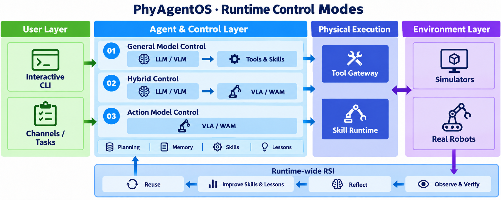

<div align="center">
  
  <h3>Recursive Self-Improvement Infrastructure for Physical Agents</h3>
  <p>
    <a href="https://arxiv.org/abs/2607.16636">Technical Report</a> ·
    <a href="https://phy-agent-os.net/">Website</a> ·
    <a href="https://github.com/PhyAgentOS/PhyAgentOS-DSH-Plugin">DSH plugin</a> ·
    <a href="docs/README.md">Documentation</a> ·
    <a href="https://discord.gg/YJztZ4wUM">Discord</a>
  </p>
  <p>
    <a href="LICENSE"></a>
    
    <a href="CHANGELOG.md"></a>
    <a href="https://github.com/PhyAgentOS/PhyAgentOS-core/stargazers"></a>
  </p>
  <p><a href="README.md">English</a> · <a href="README_zh.md">简体中文</a></p>
  <p>
    <a href="#what">What</a> ·
    <a href="#why">Why</a> ·
    <a href="#release">v1.2.0</a> ·
    <a href="#quick-start">Install</a> ·
    <a href="docs/quickstart-mujoco.md">Quickstart</a> ·
    <a href="#quickstart-examples">Examples</a> ·
    <a href="#documentation">Documentation</a>
  </p>
  <p><a href="#release"><b>v1.2.0 · DeepSeek Harness integration, benchmark policies and runtime recovery</b></a></p>
</div>

---

<a id="what"></a>
## What is PhyAgentOS?

**PhyAgentOS is a Recursive Self-Improvement (RSI) framework for embodied agents.** It connects cognitive planning, Physical Execution, and task verification in a runtime-wide feedback loop, improving Skills and Lessons from verified experience for future tasks.



<a id="why"></a>
## Why PhyAgentOS?

| Capability | What it enables |
| --- | --- |
| **One framework, multiple control modes** | Combine general-model reasoning, action models, or hybrid control through the capabilities exposed by an installed Skill. |
| **Verified task outcomes** | Evaluate goals against observations and execution facts, with bounded replanning when recovery is needed. |
| **Experience that improves future tasks** | Accumulate reusable workflows and scoped Lessons from verified experience, with guarded promotion and revision history. |
| **Reusable physical capabilities** | Package environment-specific tools and runtimes as versioned Skills, keeping cognitive planning separate from robot integration. |

<a id="release"></a>
## What's new in v1.2.0

- **Run Forge Skills from DeepSeek Harness.** Search the Registry, install a Skill, select a profile, start the runtime and call its Gateway tools from a DSH conversation. [DSH plugin repository](https://github.com/PhyAgentOS/PhyAgentOS-DSH-Plugin) · [npm package 0.2.0](https://www.npmjs.com/package/@x-era/dsh-forge/v/0.2.0)
- **Choose a benchmark and policy.** The public Registry offers five policy profiles for RoboTwin 2.0, eleven for LIBERO and two for CALVIN. The RoboDojo π0.5 developer package runs bottle-disposal episodes and can stop at episode boundaries or run consecutive episodes in one policy process. [Benchmark Skills and profiles](docs/benchmarks.md#benchmark-skills)
- **Resume long-running work.** Conversation archives save progress in chunks. Run `paos skill reconcile <skill>` to query a retained Action or Session and update its runtime bindings. The Piper walkthrough shows how to move the arm, record an MP4 and edit the recorder Node. [Session recovery](docs/FAQ.md#session-memory) · [Piper walkthrough](example/beginner-simulation/README.md)

Start DSH Web with Node.js 24.9 or later and the plugin’s supported host version.

```bash
npm install --global @deepseek-ai/dsh@0.2.2-rc.1
dsh plugin --profile web add @x-era/dsh-forge
dsh web
```

[Changelog](CHANGELOG.md) · [Changes since v1.1.1](https://github.com/PhyAgentOS/PhyAgentOS-core/compare/v1.1.1...v1.2.0)

<a id="quick-start"></a>
## Install and configure

Start with a model-backed CLI conversation, then follow the dedicated [MuJoCo Quickstart](docs/quickstart-mujoco.md). **Prerequisites:** Python 3.11 or 3.12, Git, and an API key for your model provider.

### 1. Install and initialize

```bash
git clone --branch v1.2.0 https://github.com/PhyAgentOS/PhyAgentOS-core.git
cd PhyAgentOS-core
python -m venv .venv
source .venv/bin/activate
python -m pip install -e .
paos onboard
```

For a PyPI installation, run `python -m pip install "PhyAgentOS-ai==1.2.0"` in a virtual environment, then `paos onboard`.

On Windows PowerShell, replace the activation command with `.venv\Scripts\Activate.ps1`.

### 2. Connect a model

Configure credentials with hidden input, then select the default:

```bash
paos provider configure openrouter
paos provider use openrouter --model anthropic/claude-sonnet-4
```

See the [provider CLI guide](docs/en/02-user-manual.md#2-configure-the-model-and-forge) for
Docker/secret input, process overrides and session commands (`/provider`, `/model`, `/effort`, `/status`).
Session switches apply from the next turn in the current conversation.

See the [FAQ](docs/FAQ.md) for full configuration examples, Registry downloads and troubleshooting.

### 3. Run your first request

```bash
paos status
paos agent -m "Hello! Introduce yourself."
paos agent
```

You should receive a model response; `paos agent` opens an interactive conversation. This checks the core Agent and provider connection. Physical execution additionally needs a running Skill Runtime.

Need another provider or deployment option? See the [user manual](docs/en/02-user-manual.md) · [Docker](docs/user_manual/DOCKER.md).

<a id="robot-skills"></a>
New to embodied agents? Follow the [beginner simulation walkthrough](example/beginner-simulation/README.md) for conversational CLI use, an MP4 recording Node and an editable-node exercise ([Linux functional report](example/beginner-simulation/VALIDATION.md)).

<a id="simulation-quickstart"></a>
<a id="quickstart-examples"></a>
## More examples

| Platform | Coverage | Guide |
| --- | --- | --- |
| Piper MuJoCo simulation | Dora and Skill setup, joint/Cartesian control, and shutdown recovery | [MuJoCo Quickstart](docs/quickstart-mujoco.md) |
| Piper robot arm | Skill installation, CAN setup, hardware startup, and tool readiness | [Piper quickstart (Chinese)](example/quickstart/piper-quickstart.md) |
| LIBERO-10 simulation benchmark | Skill/Node installation, π0.5 weights, model API setup, and a 50-episode run (π0.5-only or GPT-6 supervised) | [LIBERO quickstart (Chinese)](example/quickstart/libero-quickstart.md) |

<a id="documentation"></a>
## Documentation

| I want to… | Start here |
| --- | --- |
| Resolve downloads, configuration, or session recovery questions | [FAQ](docs/FAQ.md) |
| Install, configure, and run PhyAgentOS | [User manual](docs/en/02-user-manual.md) |
| Build a Skill or connect an environment | [TrackB development guide](docs/user_development_guide/track_b/README.md) |
| Understand the Physical Execution API | [Physical Execution Tool API](docs/forge/README.md) |
| Extend robot-control-sim to another arm | [Piper X development demo](docs/user_development_guide/PIPER_X_DEMO.md) |
| Develop and test Core | [Core developer manual](docs/en/03-developer-manual.md) |
| Inspect benchmark results and evaluation context | [Benchmark documentation](docs/benchmarks.md) |
| Browse all documentation | [Documentation index](docs/README.md) |

<a id="news"></a>
## News

**2026-11-22 · v1.2.0 released.** Run Forge Skills from DeepSeek Harness, choose policies across benchmark suites and recover session and runtime state. [Release notes and packages](https://github.com/PhyAgentOS/PhyAgentOS-core/releases/tag/v1.2.0)

**2026-10-23 · v1.1.1 released:** Opper gateway support, local Skill development and Action rejection fixes, plus bilingual Track B and Piper X guides. [Release notes and packages](https://github.com/PhyAgentOS/PhyAgentOS-core/releases/tag/v1.1.1).

**2026-10-10 · GOSIM Shenzhen 2026:** PhyAgentOS has been selected for Spotlight and will present in the Open Source Robotics track. [Read the announcement and event details](docs/news/gosim-shenzhen-2026.md).

| Version | Date | Update |
| --- | --- | --- |
| **v1.2.0** | 2026-11-22 | DeepSeek Harness plugin entry point, benchmark policy profiles, checkpointed conversation archives and Skill runtime recovery. |
| **v1.1.1** | 2026-10-23 | Opper gateway, local Skill development and Action rejection fixes, bilingual Track B and Piper X guides, and a MuJoCo Quickstart. |
| **v1.1.0** | 2026-10-09 | Centralized provider management, direct OpenAI Responses and new gateways, Skill Runtime packaging and startup improvements, and an opt-in governed interaction foundation. |
| **v1.0.0** | 2026-08-30 | Initial stable release of PhyAgentOS. |
| **v0.2.3** | 2026-08-27 | Physical Execution Skills can be installed and managed independently, activated into immutable AgentTask bindings, and used through governed Query, Action, and Session Tool API lifecycles with recovery and version-scoped experience. |
| **v0.2.2** | 2026-08-21 | Unified Physical Execution execution on the Query/Action Tool API and added AgentTask aggregation, a verifiable Skill Runtime, Resource Registry integration, and the move-arm-by-ee Skill while retaining Agent verification and evolution. |

See the [full changelog](CHANGELOG.md).

## Contributing & community

Contribute TrackB Nodes, package Skills, or connect a robot or simulator. The guide covers local development, source review and maintainer-led resource registration. [Contribution guide](CONTRIBUTING.md)

<details>
<summary>Development checks</summary>

```bash
python -m pip install -e ".[dev]"
pytest
ruff check PhyAgentOS tests
python -m compileall -q PhyAgentOS tests
```

</details>

[Discord](https://discord.gg/YJztZ4wUM) · [X](https://x.com/phyagentos) · [Bilibili](https://space.bilibili.com/3546880296355920) · [LinkedIn](https://www.linkedin.com/in/phyagent-os-252372401/) · [Xiaohongshu](https://www.xiaohongshu.com/user/profile/673d83e3000000001c01a183)

## Citation & acknowledgements

If PhyAgentOS helps your research, please cite our [technical report](https://arxiv.org/abs/2607.16636).

```bibtex
@article{liu2026phyagentos,
  title={PhyAgentOS: A Self-Evolving Operating System for Embodied Agents with Decoupled Cognitive Planning and Physical Execution},
  author={Liu, Yang and Chen, Weixing and Song, Xinshuai and Pu, Tao and Mo, Siwen and Bai, Yongjie and Chen, Zihao and Sun, Qianran and Zhong, Liruo and Shen, Ying and others},
  journal={arXiv preprint arXiv:2607.16636},
  year={2026}
}
```

Thanks to the maintainers of MuJoCo, ROS, the open benchmark suites, and every contributor to PhyAgentOS.

---

<div align="center">
  <p>Jointly developed by <b>Sun Yat-sen University HCP Lab</b>, <b>Peng Cheng Laboratory</b>, and <b>X-Era Lab</b>.</p>
  &nbsp;&nbsp;
  &nbsp;&nbsp;
  
  <p><sub>MIT License · Copyright © 2025–2026 PhyAgentOS</sub></p>
</div>
