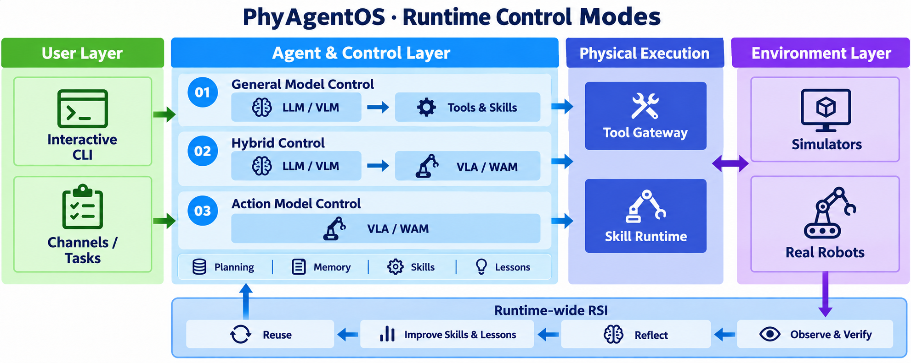

<div align="center">
  
  <h3>面向具身智能体的递归自进化基础设施</h3>
  <p>
    <a href="https://arxiv.org/abs/2607.16636">技术报告</a> ·
    <a href="https://phy-agent-os.net/">官网</a> ·
    <a href="https://github.com/PhyAgentOS/PhyAgentOS-DSH-Plugin">DSH 插件</a> ·
    <a href="docs/README_zh.md">文档</a> ·
    <a href="https://discord.gg/YJztZ4wUM">Discord</a>
  </p>
  <p>
    <a href="LICENSE"></a>
    
    <a href="CHANGELOG.md"></a>
    <a href="https://github.com/PhyAgentOS/PhyAgentOS-core/stargazers"></a>
  </p>
  <p><a href="README.md">English</a> · <a href="README_zh.md">简体中文</a></p>
  <p>
    <a href="#what">What</a> ·
    <a href="#why">Why</a> ·
    <a href="#release">v1.1.1</a> ·
    <a href="#quick-start">安装配置</a> ·
    <a href="docs/quickstart-mujoco_zh.md">仿真 Quickstart</a> ·
    <a href="#quickstart-examples">快速启动示例</a> ·
    <a href="#documentation">文档导航</a>
  </p>
  <p><a href="#release"><b>v1.1.1 · Skill 开发、执行可靠性与 Opper 网关</b></a></p>
</div>

---

<a id="what"></a>
## What · PhyAgentOS 是什么？

**PhyAgentOS 是面向具身智能体的递归自进化（RSI）框架。** 它将认知规划、Physical Execution 与任务验证连接为跨 Runtime 的反馈闭环，从经过验证的经验中改进 Skill 与 Lesson，并用于后续任务。



<a id="why"></a>
## Why · 为什么选择 PhyAgentOS？

| 核心能力 | 带来的价值 |
| --- | --- |
| **一套框架，多种控制方式** | 通过已安装 Skill 暴露的能力，接入通用模型、动作模型或混合控制。 |
| **以任务结果为准的验证** | 结合观测和执行事实判断目标是否达成，需要恢复时支持有预算的重新规划。 |
| **让经验改进后续任务** | 从经过验证的经验中积累可复用工作流与作用域 Lesson，并通过受控晋升和版本记录管理改进。 |
| **可复用的物理执行能力** | 将环境相关工具与 Runtime 封装为版本化 Skill，使认知规划与机器人接入保持解耦。 |

<a id="release"></a>
## v1.1.1 更新亮点

**Skill 开发、执行可靠性与 Opper 网关。** 相对 v1.1.0 的主要变化：

- **Opper 网关：** 新增 OpenAI 兼容接入，支持 Provider 选择、环境变量凭据和原样传递模型标识。
- **本地 Skill 开发：** 本地修改工作流文档和 Node 可执行文件后可带警告运行，绑定与经验仍记录实际激活的工作流哈希；显式 Node 校验和安装缓存验收保持严格。
- **Action 拒绝处理：** Gateway 明确在分发前拒绝的请求记为失败，不再阻塞后续重试或成功任务的最终判定；超时和远端执行不确定时仍保留原有保护。
- **Piper X 开发示例：** 双语 Track B 指南与独立仿真 Skill 示例覆盖模型转换、原始 Node locks、打包和历史验证记录；原始运行基线见 [Piper X 指南](docs/user_development_guide/PIPER_X_DEMO_zh.md)。
- **文档整理：** 合并双语手册和贡献指南，新增带实时 GIF 的 MuJoCo Quickstart，并保留评测文档入口。

查看[完整更新记录](CHANGELOG.md)和[相对 v1.1.0 的全部变更](https://github.com/PhyAgentOS/PhyAgentOS-core/compare/v1.1.0...v1.1.1)。

<a id="quick-start"></a>
## 安装与配置

先运行模型驱动的 CLI 对话，再按独立的 [MuJoCo Quickstart](docs/quickstart-mujoco_zh.md) 操控仿真机器人。**准备：** Python 3.11 或 3.12、Git，以及模型服务的 API Key。

### 1. 安装与初始化

```bash
git clone --branch v1.1.1 https://github.com/PhyAgentOS/PhyAgentOS-core.git
cd PhyAgentOS-core
python -m venv .venv
source .venv/bin/activate
python -m pip install -e .
paos onboard
```

Windows PowerShell 请将激活命令替换为 `.venv\Scripts\Activate.ps1`。

### 2. 配置模型

通过隐藏输入配置密钥，再选择默认 Provider：

```bash
paos provider configure openrouter
paos provider use openrouter --model anthropic/claude-sonnet-4
```

Docker/Secret 输入、进程启动覆盖和 `/provider`、`/model`、`/effort`、`/status` 会话命令见
[Provider CLI 指南](docs/zh/02-user-manual.md#2-配置模型与-forge)。会话切换只影响后续请求，
不改变正在执行的任务及其他会话。

完整配置示例、资源下载地址和排障见 [FAQ](docs/FAQ_zh.md)。

### 3. 运行第一条请求

```bash
paos status
paos agent -m "Hello! Introduce yourself."
paos agent
```

收到模型回复即完成核心 Agent 与模型服务的连通检查；`paos agent` 会打开交互式对话。执行物理任务还需要启动对应的 Skill Runtime。

其他模型服务与部署方式见 [用户手册](docs/zh/02-user-manual.md) · [Docker 部署](docs/user_manual/DOCKER_zh.md).

<a id="robot-skills"></a>
<a id="simulation-quickstart"></a>
<a id="quickstart-examples"></a>
## 更多示例

| 平台 | 内容 | 指南 |
| --- | --- | --- |
| Piper MuJoCo 仿真 | Dora、Skill 安装、关节与末端控制，以及停止恢复 | [MuJoCo Quickstart](docs/quickstart-mujoco_zh.md) |
| Piper 机械臂 | Skill 安装、CAN 配置、真机启动与工具就绪验证 | [Piper 快速启动](example/quickstart/piper-quickstart.md) |
| LIBERO-10 仿真评测 | Skill/Node 安装、π0.5 权重、模型 API 配置与 50 集测评（π0.5 纯策略 / GPT-6 监督两条路线） | [LIBERO 快速启动](example/quickstart/libero-quickstart.md) |

<a id="documentation"></a>
## 文档导航

| 我想…… | 阅读入口 |
| --- | --- |
| 资源下载、完整配置与会话恢复 | [FAQ](docs/FAQ_zh.md) |
| 安装、配置并运行 PhyAgentOS | [用户手册](docs/zh/02-user-manual.md) |
| 开发 Skill 或接入新环境 | [TrackB 开发指南](docs/user_development_guide/track_b/README_zh.md) |
| 了解 Physical Execution API | [Physical Execution Tool API](docs/forge/README_zh.md) |
| 为 robot-control-sim 接入另一种机械臂 | [Piper X 二次开发 demo](docs/user_development_guide/PIPER_X_DEMO_zh.md) |
| 开发与测试 Core | [Core 开发者手册](docs/zh/03-developer-manual.md) |
| 查看测评结果与评测口径 | [Benchmark 文档](docs/benchmarks.md) |
| 浏览全部文档 | [文档索引](docs/README_zh.md) |

<a id="news"></a>
## News · 最新动态

**2026-10-23 · v1.1.1 发布：** 新增 Opper 网关，完善本地 Skill 开发和 Action 拒绝处理，并补充双语 Track B 与 Piper X 开发指南。[查看发布说明与安装包](https://github.com/PhyAgentOS/PhyAgentOS-core/releases/tag/v1.1.1)。

**2026-10-10 · GOSIM Shenzhen 2026：** PhyAgentOS 入选 Spotlight，并将在开源机器人分论坛做主题分享。[查看活动公告与现场信息](docs/news/gosim-shenzhen-2026_zh.md)。

| 版本 | 日期 | 更新 |
| --- | --- | --- |
| **v1.1.1** | 2026-10-23 | Opper 网关、本地 Skill 开发与 Action 拒绝处理修复、双语 Track B 和 Piper X 指南，以及 MuJoCo Quickstart。 |
| **v1.1.0** | 2026-10-09 | 集中式 Provider 管理、直接 OpenAI Responses 与新网关接入、Skill Runtime 打包和启动改进，以及默认关闭的受治理交互基础。 |
| **v1.0.0** | 2026-08-30 | Initial stable release of PhyAgentOS. |
| **v0.2.3** | 2026-08-27 | Physical Execution Skill 可独立安装和管理，经显式激活冻结到 AgentTask，并通过受治理的 Query、Action、Session Tool API 生命周期执行，支持恢复和按版本限定的经验。 |
| **v0.2.2** | 2026-08-21 | 将 Physical Execution 执行统一到 Query/Action Tool API，并增加 AgentTask 聚合、可校验 Skill Runtime、Resource Registry 接入和 move-arm-by-ee Skill，同时保留 Agent 验证与演化能力。 |

查看[完整更新记录](CHANGELOG.md)。

## 参与贡献与社区

请先阅读[贡献指南](CONTRIBUTING_zh.md)与开发手册，建议优先参与 TrackB 的 Node、Skill 和机器人/环境接入开发。资源平台的外部贡献提交及已有登记仓库修改暂未开放，需等待审批服务完成并开放后支持；现阶段可进行本地开发验证，具体范围与源码评审流程见贡献指南。

<details>
<summary>开发检查命令</summary>

```bash
python -m pip install -e ".[dev]"
pytest
ruff check PhyAgentOS tests
python -m compileall -q PhyAgentOS tests
```

</details>

[Discord](https://discord.gg/YJztZ4wUM) · [X](https://x.com/phyagentos) · [Bilibili](https://space.bilibili.com/3546880296355920) · [LinkedIn](https://www.linkedin.com/in/phyagent-os-252372401/) · [小红书](https://www.xiaohongshu.com/user/profile/673d83e3000000001c01a183)

## 引用与致谢

如果 PhyAgentOS 对你的研究有帮助，欢迎引用我们的[技术报告](https://arxiv.org/abs/2607.16636)。

```bibtex
@article{liu2026phyagentos,
  title={PhyAgentOS: A Self-Evolving Operating System for Embodied Agents with Decoupled Cognitive Planning and Physical Execution},
  author={Liu, Yang and Chen, Weixing and Song, Xinshuai and Pu, Tao and Mo, Siwen and Bai, Yongjie and Chen, Zihao and Sun, Qianran and Zhong, Liruo and Shen, Ying and others},
  journal={arXiv preprint arXiv:2607.16636},
  year={2026}
}
```

感谢 MuJoCo、ROS、各开放基准的维护者，以及所有 PhyAgentOS 贡献者。

---

<div align="center">
  <p>由 <b>中山大学 HCP 实验室</b>、<b>鹏城实验室</b> 与 <b>拓元智慧</b> 联合开发。</p>
  &nbsp;&nbsp;
  &nbsp;&nbsp;
  
  <p><sub>MIT License · Copyright © 2025–2026 PhyAgentOS</sub></p>
</div>
