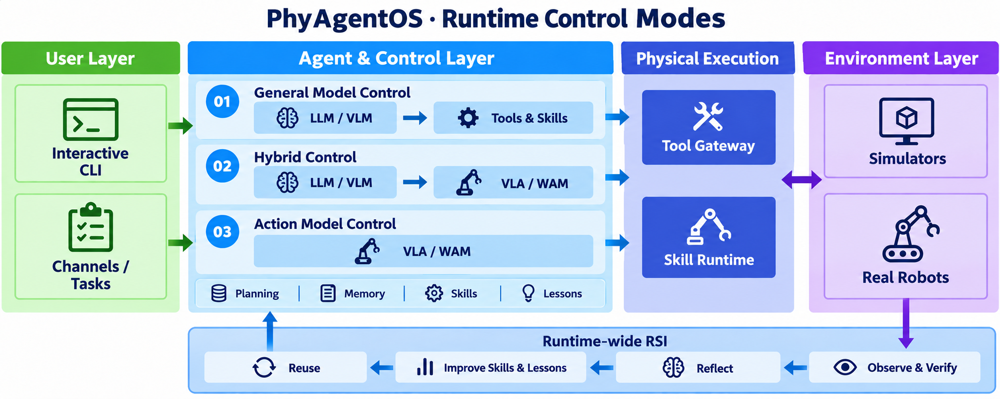
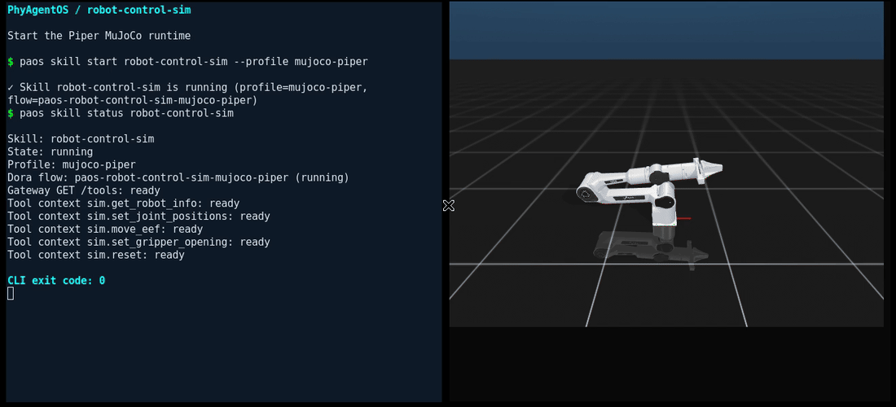
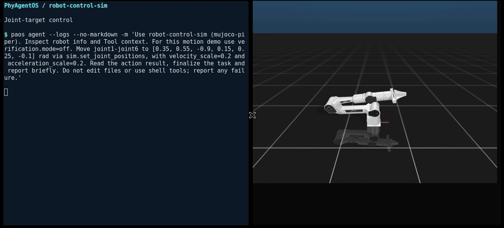
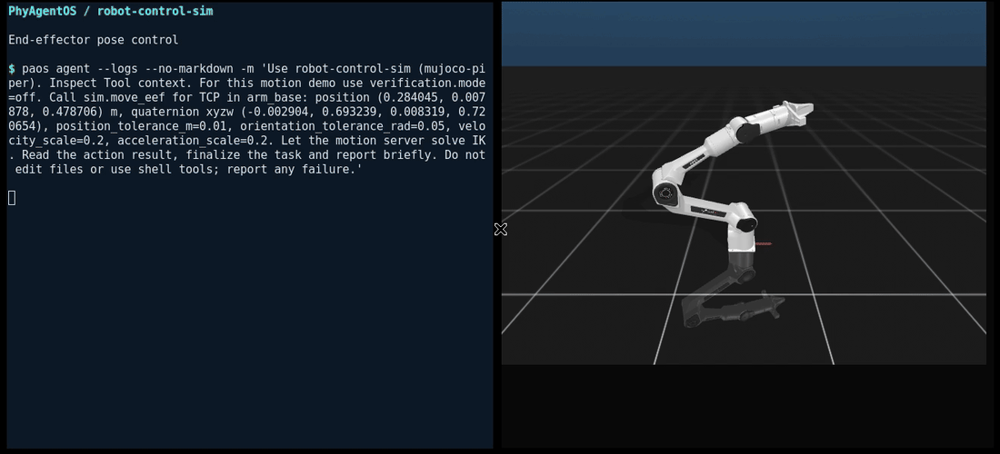

<div align="center">
  
  <h3>面向具身智能体的递归自进化基础设施</h3>
  <p>
    <a href="https://arxiv.org/abs/2607.16636">技术报告</a> ·
    <a href="https://phy-agent-os.net/">官网</a> ·
    <a href="docs/README_zh.md">文档</a> ·
    <a href="https://discord.gg/YJztZ4wUM">Discord</a>
  </p>
  <p>
    <a href="LICENSE"></a>
    
    <a href="CHANGELOG.md"></a>
    <a href="https://github.com/PhyAgentOS/PhyAgentOS-core/stargazers"></a>
  </p>
  <p><a href="README.md">English</a> · <a href="README_zh.md">简体中文</a></p>
  <p>
    <a href="#what">What</a> ·
    <a href="#why">Why</a> ·
    <a href="#release">v1.1.1</a> ·
    <a href="#quick-start">安装配置</a> ·
    <a href="#simulation-quickstart">仿真 Quickstart</a> ·
    <a href="#quickstart-examples">快速启动示例</a> ·
    <a href="#documentation">文档导航</a>
  </p>
  <p><a href="#release"><b>v1.1.1 · Skill 开发、执行可靠性与 Opper 网关</b></a></p>
</div>

---

<a id="what"></a>
## What · PhyAgentOS 是什么？

**PhyAgentOS 是面向具身智能体的递归自进化（RSI）框架。** 它将认知规划、Physical Execution 与任务验证连接为跨 Runtime 的反馈闭环，从经过验证的经验中改进 Skill 与 Lesson，并用于后续任务。



<a id="why"></a>
## Why · 为什么选择 PhyAgentOS？

| 核心能力 | 带来的价值 |
| --- | --- |
| **一套框架，多种控制方式** | 通过已安装 Skill 暴露的能力，接入通用模型、动作模型或混合控制。 |
| **以任务结果为准的验证** | 结合观测和执行事实判断目标是否达成，需要恢复时支持有预算的重新规划。 |
| **让经验改进后续任务** | 从经过验证的经验中积累可复用工作流与作用域 Lesson，并通过受控晋升和版本记录管理改进。 |
| **可复用的物理执行能力** | 将环境相关工具与 Runtime 封装为版本化 Skill，使认知规划与机器人接入保持解耦。 |

<a id="release"></a>
## v1.1.1 更新亮点

**Skill 开发、执行可靠性与 Opper 网关。** 相对 v1.1.0 的主要变化：

- **Opper 网关：** 新增 OpenAI 兼容接入，支持 Provider 选择、环境变量凭据和原样传递模型标识。
- **本地 Skill 开发：** 本地修改工作流文档和 Node 可执行文件后可带警告运行，绑定与经验仍记录实际激活的工作流哈希；显式 Node 校验和安装缓存验收保持严格。
- **Action 拒绝处理：** Gateway 明确在分发前拒绝的请求记为失败，不再阻塞后续重试或成功任务的最终判定；超时和远端执行不确定时仍保留原有保护。
- **Piper X 开发示例：** 双语 Track B 指南与独立仿真 Skill 示例覆盖模型转换、原始 Node locks、打包和历史验证记录；原始运行基线见 [Piper X 指南](docs/user_development_guide/PIPER_X_DEMO_zh.md)。
- **文档整理：** 合并双语手册和贡献指南，新增带实时 GIF 的 MuJoCo Quickstart，并保留评测文档入口。

查看[完整更新记录](CHANGELOG.md)和[相对 v1.1.0 的全部变更](https://github.com/PhyAgentOS/PhyAgentOS-core/compare/v1.1.0...v1.1.1)。

<a id="quick-start"></a>
## 安装与配置

先运行模型驱动的 CLI 对话，再按下文的 [MuJoCo Quickstart](#simulation-quickstart) 操控仿真机器人。**准备：** Python 3.11 或 3.12、Git，以及模型服务的 API Key。

### 1. 安装与初始化

```bash
git clone --branch v1.1.1 https://github.com/PhyAgentOS/PhyAgentOS-core.git
cd PhyAgentOS-core
python -m venv .venv
source .venv/bin/activate
python -m pip install -e .
paos onboard
```

Windows PowerShell 请将激活命令替换为 `.venv\Scripts\Activate.ps1`。

### 2. 配置模型

通过隐藏输入配置密钥，再选择默认 Provider：

```bash
paos provider configure openrouter
paos provider use openrouter --model anthropic/claude-sonnet-4
```

Docker/Secret 输入、进程启动覆盖和 `/provider`、`/model`、`/effort`、`/status` 会话命令见
[Provider CLI 指南](docs/zh/02-user-manual.md#2-配置模型与-forge)。会话切换只影响后续请求，
不改变正在执行的任务及其他会话。

<details>
<summary>完整配置参考（v1.1.1）</summary>

配置保存为 camelCase，同时也接受 snake_case 输入。

```json
{
  "agents": {
    "defaults": {
      "workspace": "~/.PhyAgentOS/workspace",
      "model": "openrouter/openai/gpt-4o-mini",
      "provider": "openrouter"
    },
    "verification": {
      "serviceEnabled": true,
      "evidenceRetention": "failed",
      "maxReplansPerEpisode": 2,
      "maxVerifierCallsPerRun": 50
    },
    "evolution": {
      "enabled": true,
      "scope": "verified_forge_lineage",
      "promotionMode": "guarded_auto",
      "minSuccessfulEpisodes": 3,
      "minLessonEpisodes": 3,
      "maxLessonsPerSkill": 8,
      "maxEvolutionCallsPerRun": 20
    }
  },
  "providers": {
    "openrouter": {
      "apiKey": "YOUR_API_KEY"
    }
  },
  "forge": {
    "requestTimeoutS": 10,
    "pollIntervalS": 0.5,
    "executionTimeoutS": 300,
    "evidence": {
      "requiredImageSources": ["front"],
      "captureTimeoutS": 5,
      "postCaptureTimeoutS": 5,
      "connectionTimeoutS": 2,
      "maxArtifactBytes": 8388608,
      "associationQuality": "best_effort"
    }
  },
  "resourceRegistry": {
    "url": "https://paos-resource-manager.dev.x-era.com"
  }
}
```

`front` 只是示例。`resourceRegistry.url` 用于选择通用制品仓库；全部制品都从本地 Bundle
或显式静态 index 安装时可留空。PAOS 只连接到已显式启动且健康的 Skill Runtime manifest
所声明的 Gateway URL；启动 Agent 不会隐式启动或下载某个具体 Skill。

</details>

### 3. 运行第一条请求

```bash
paos status
paos agent -m "Hello! Introduce yourself."
paos agent
```

收到模型回复即完成核心 Agent 与模型服务的连通检查；`paos agent` 会打开交互式对话。执行物理任务还需要启动对应的 Skill Runtime。

其他模型服务与部署方式见 [用户手册](docs/zh/02-user-manual.md) · [Docker 部署](docs/user_manual/DOCKER_zh.md).

<a id="robot-skills"></a>
<a id="simulation-quickstart"></a>
## Quickstart · 在 MuJoCo 中操控机器人

> [!TIP]
> **开发者接入自己的机械臂：直接查看 [Piper X 完整二次开发 demo](docs/user_development_guide/PIPER_X_DEMO_zh.md)。**
> 从模型转换到 Skill 组装，跑通关节与末端位姿控制；配合 [Skill 开发手册](docs/user_development_guide/track_b/SKILL_DEVELOPMENT_zh.md)，选择配置修改、新增 profile 或独立 Node 开发。

以 **`robot-control-sim`** 为例，通过关节目标或末端位姿控制仿真 Piper 机械臂。
请先完成上方安装与模型配置。本例使用的预构建仿真 Node 面向 **Linux x86_64**，
MuJoCo 和图像查看器需要可用的图形显示或虚拟显示环境。

### 1. 安装 Dora

v1.1.1 沿用 Dora CLI **0.4.1**（`dora-message` **0.7.0**）兼容基线：

```bash
curl --proto '=https' --tlsv1.2 -LsSf \
  https://github.com/dora-rs/dora/releases/download/v0.4.1/dora-cli-installer.sh | sh
dora --version
```

启动仿真 Runtime 需要 Dora；其他安装方式见 [Dora 安装参考](docs/zh/02-user-manual.md#托管-skill-profile-所需的-dora-cli)。

### 2. 安装 robot-control-sim

在配置中设置 `resourceRegistry.url`，或通过 `PAOS_RESOURCE_REGISTRY_URL` 指向提供
`robot-control-sim` 及其锁定 Node 制品的部署，再运行：

```bash
paos skill search robot-control-sim
paos skill install robot-control-sim
paos skill inspect robot-control-sim
```

`inspect` 显示已安装版本、profile 与依赖。本例使用 `mujoco-piper`；也可选择
`mujoco-franka` 或 `mujoco-so101` 切换机器人。独立获取的 Bundle 可用
`paos skill install /path/to/robot-control-sim.tar.gz --local` 安装，所锁定的 Node 也需可获取。
Core 不内置这些仿真资源。

### 3. 启动仿真

```bash
paos skill start robot-control-sim --profile mujoco-piper
paos skill status robot-control-sim
```

等待 Runtime 报告健康并打开仿真相机查看器。启动失败时，先通过
`paos skill logs robot-control-sim` 定位问题，再提交运动请求。



### 4. 按关节目标和末端位姿控制

Agent 读取 `sim.get_robot_info` 与实时 Tool context，确认关节、限位、坐标系和单位，
再按活动 Skill 的工作流执行。下方绝对目标适用于 `mujoco-piper`（`arm_base` / `tcp`）；
切换 profile 时应使用对应机器人的坐标系和可达目标。

| 控制方式 | Tool | 目标 |
| --- | --- | --- |
| 关节目标 | `sim.set_joint_positions` | 机械臂各关节的绝对位置，单位为弧度 |
| 末端位姿 | `sim.move_eef` | 以米表示的绝对位置及四元数姿态，由 motion server 求解 IK |

运动演示使用 `verification.mode=off`，按 Tool 执行结果判断完成；语义任务验证与证据策略见 [Core 开发者手册](docs/zh/03-developer-manual.md#7-verification-与-recovery)。

先尝试关节空间请求：

```bash
paos agent -m "使用 robot-control-sim 的 mujoco-piper。 \
  检查机器人信息和 Tool context，本次运动演示使用 verification.mode=off。 \
  通过 sim.set_joint_positions 将 joint1-joint6 移动到 [0.35, 0.55, -0.9, 0.15, 0.25, -0.1] rad， \
  velocity_scale 和 acceleration_scale 均为 0.2。 \
  读取动作结果、finalize 任务并简要报告。 \
  不修改文件、不使用 shell 工具；失败时直接报告。"
```



再尝试末端位姿请求：

```bash
paos agent -m "使用 robot-control-sim 的 mujoco-piper。 \
  检查 Tool context，本次运动演示使用 verification.mode=off。 \
  调用 sim.move_eef，将 TCP 移到 arm_base 下的位置 (0.284045, 0.007878, 0.478706) m， \
  四元数 xyzw 为 (-0.002904, 0.693239, 0.008319, 0.720654)， \
  position_tolerance_m=0.01、orientation_tolerance_rad=0.05， \
  velocity_scale 和 acceleration_scale 均为 0.2。 \
  由 motion server 求解 IK；读取动作结果、finalize 任务并简要报告。 \
  不修改文件、不使用 shell 工具；失败时直接报告。"
```



*以上为命令与 MuJoCo 仿真的运行实录，命令画面固定保留以便阅读，并已缩短模型等待停顿。*

也可运行 `paos agent` 进入交互控制。应能在仿真中观察到运动；以返回的执行结果和最终状态为准，
不把请求已接纳当作动作已完成。

### 5. 停止仿真

运动任务结束后执行：

```bash
paos skill stop robot-control-sim
```

### 在此基础上二次开发

- [TrackB 框架说明](docs/user_development_guide/track_b/README_zh.md)：整体架构、仓库目录与节点协议。
- [Skill 开发手册](docs/user_development_guide/track_b/SKILL_DEVELOPMENT_zh.md)：修改 profile、增加 profile，以及独立开发 Node 并组装 Skill。
- [Piper X 二次开发 demo](docs/user_development_guide/PIPER_X_DEMO_zh.md)：为 `robot-control-sim` 接入另一种机械臂，包含模型转换与两种控制方式。
- [Bundle 与 Tool 接入参考](docs/user_development_guide/README_zh.md)：manifest 字段、打包和本地安装。

### 会话记忆与恢复

`contextWindowTokens` 控制会话归档阈值及保守的请求预算。每次模型请求都预留输出空间并保留最近一轮完整对话；旧轮次可以从请求中移除，但不会从原始会话中删除。如果当前轮次或系统指令本身已超预算，PAOS 会明确报错停止，不发送超限请求，也不移除执行证据。

记忆归档采用自动工具选择，并严格校验 `save_memory` 的返回结果。超大历史按预算分片处理，持久化进度以支持失败续跑。归档失败会显示在回复中，自动重试暂停 60 秒。`/new` 首先将完整原始会话备份到 `<workspace>/sessions/archives/`；即使模型归档失败，仍会开启新会话并告知备份路径。原始备份保留对话和待完成的归档检查点，供后续恢复；备份不等于已完成记忆摘要。

<a id="quickstart-examples"></a>
## 更多示例

| 平台 | 内容 | 指南 |
| --- | --- | --- |
| Piper 机械臂 | Skill 安装、CAN 配置、真机启动与工具就绪验证 | [Piper 快速启动](example/quickstart/piper-quickstart.md) |
| LIBERO-10 仿真评测 | Skill/Node 安装、π0.5 权重、模型 API 配置与 50 集测评（π0.5 纯策略 / GPT-6 监督两条路线） | [LIBERO 快速启动](example/quickstart/libero-quickstart.md) |

<a id="documentation"></a>
## 文档导航

| 我想…… | 阅读入口 |
| --- | --- |
| 安装、配置并运行 PhyAgentOS | [用户手册](docs/zh/02-user-manual.md) |
| 开发 Skill 或接入新环境 | [TrackB 开发指南](docs/user_development_guide/track_b/README_zh.md) |
| 了解 Physical Execution API | [Physical Execution Tool API](docs/forge/README_zh.md) |
| 为 robot-control-sim 接入另一种机械臂 | [Piper X 二次开发 demo](docs/user_development_guide/PIPER_X_DEMO_zh.md) |
| 开发与测试 Core | [Core 开发者手册](docs/zh/03-developer-manual.md) |
| 查看测评结果与评测口径 | [Benchmark 文档](docs/benchmarks.md) |
| 浏览全部文档 | [文档索引](docs/README_zh.md) |

<a id="news"></a>
## News · 最新动态

**2026-10-23 · v1.1.1 发布：** 新增 Opper 网关，完善本地 Skill 开发和 Action 拒绝处理，并补充双语 Track B 与 Piper X 开发指南。[查看发布说明与安装包](https://github.com/PhyAgentOS/PhyAgentOS-core/releases/tag/v1.1.1)。

**2026-10-10 · GOSIM Shenzhen 2026：** PhyAgentOS 入选 Spotlight，并将在开源机器人分论坛做主题分享。[查看活动公告与现场信息](docs/news/gosim-shenzhen-2026_zh.md)。

| 版本 | 日期 | 更新 |
| --- | --- | --- |
| **v1.1.1** | 2026-10-23 | Opper 网关、本地 Skill 开发与 Action 拒绝处理修复、双语 Track B 和 Piper X 指南，以及 MuJoCo Quickstart。 |
| **v1.1.0** | 2026-10-09 | 集中式 Provider 管理、直接 OpenAI Responses 与新网关接入、Skill Runtime 打包和启动改进，以及默认关闭的受治理交互基础。 |
| **v1.0.0** | 2026-08-30 | Initial stable release of PhyAgentOS. |
| **v0.2.3** | 2026-08-27 | Physical Execution Skill 可独立安装和管理，经显式激活冻结到 AgentTask，并通过受治理的 Query、Action、Session Tool API 生命周期执行，支持恢复和按版本限定的经验。 |
| **v0.2.2** | 2026-08-21 | 将 Physical Execution 执行统一到 Query/Action Tool API，并增加 AgentTask 聚合、可校验 Skill Runtime、Resource Registry 接入和 move-arm-by-ee Skill，同时保留 Agent 验证与演化能力。 |

查看[完整更新记录](CHANGELOG.md)。

## 参与贡献与社区

请先阅读[贡献指南](CONTRIBUTING_zh.md)与开发手册，建议优先参与 TrackB 的 Node、Skill 和机器人/环境接入开发。资源平台的外部贡献提交及已有登记仓库修改暂未开放，需等待审批服务完成并开放后支持；现阶段可进行本地开发验证，具体范围与源码评审流程见贡献指南。

<details>
<summary>开发检查命令</summary>

```bash
python -m pip install -e ".[dev]"
pytest
ruff check PhyAgentOS tests
python -m compileall -q PhyAgentOS tests
```

</details>

[Discord](https://discord.gg/YJztZ4wUM) · [X](https://x.com/phyagentos) · [Bilibili](https://space.bilibili.com/3546880296355920) · [LinkedIn](https://www.linkedin.com/in/phyagent-os-252372401/) · [小红书](https://www.xiaohongshu.com/user/profile/673d83e3000000001c01a183)

## 引用与致谢

如果 PhyAgentOS 对你的研究有帮助，欢迎引用我们的[技术报告](https://arxiv.org/abs/2607.16636)。

```bibtex
@article{liu2026phyagentos,
  title={PhyAgentOS: A Self-Evolving Operating System for Embodied Agents with Decoupled Cognitive Planning and Physical Execution},
  author={Liu, Yang and Chen, Weixing and Song, Xinshuai and Pu, Tao and Mo, Siwen and Bai, Yongjie and Chen, Zihao and Sun, Qianran and Zhong, Liruo and Shen, Ying and others},
  journal={arXiv preprint arXiv:2607.16636},
  year={2026}
}
```

感谢 MuJoCo、ROS、各开放基准的维护者，以及所有 PhyAgentOS 贡献者。

---

<div align="center">
  <p>由 <b>中山大学 HCP 实验室</b>、<b>鹏城实验室</b> 与 <b>拓元智慧</b> 联合开发。</p>
  &nbsp;&nbsp;
  &nbsp;&nbsp;
  
  <p><sub>MIT License · Copyright © 2025–2026 PhyAgentOS</sub></p>
</div>
