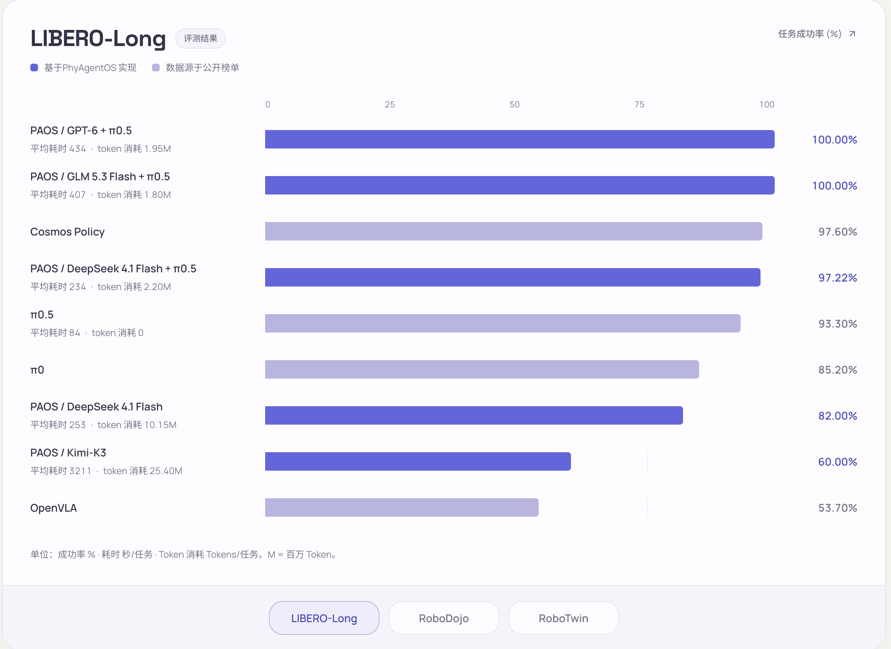
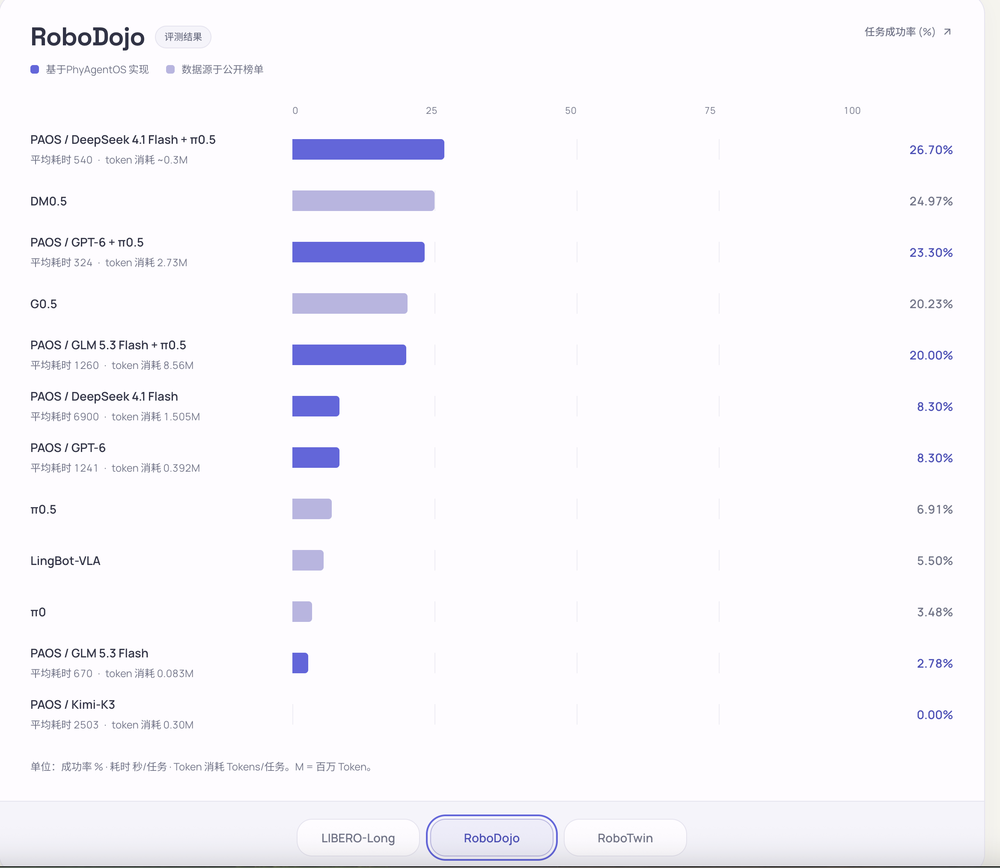
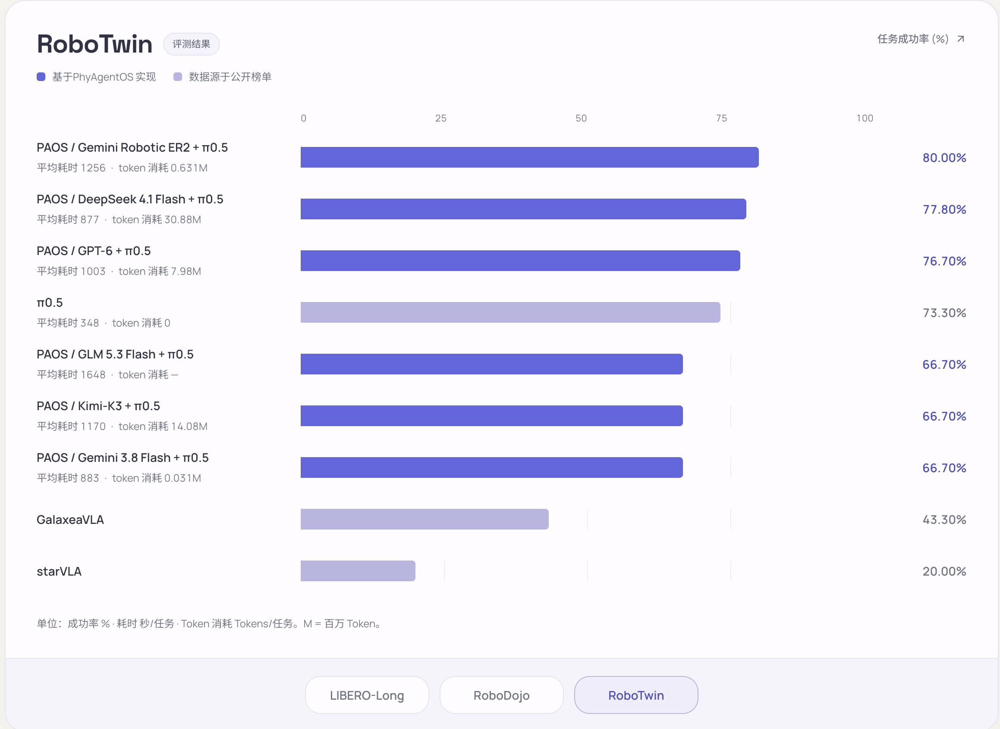

# Benchmark results / 测评结果

[English README](../README.md) · [中文 README](../README_zh.md)

<a id="benchmark-skills"></a>
## Benchmark Skills / 评测 Skill

Choose a Skill for the environment and a profile for the policy. Each benchmark records the episode outcome using its native scoring rules. 按评测环境选择 Skill，按策略选择 profile，每个回合由相应基准按原生规则评分。

| Benchmark | Distribution / 获取方式 | Profiles / 配置 | Evaluation / 评测方式 |
| --- | --- | --- | --- |
| RoboTwin 2.0 | [`robotwin-benchmark` 0.3.1](https://paos-resource-platform.dev.x-era.com/v1/skills/robotwin-benchmark?version=0.3.1) | `g05`, `pi05`, `smolvla`, `act`, `lingbot_va` | Dual-arm manipulation. ACT uses task 38, `put_bottles_dustbin`. 双臂操作，ACT 对应第 38 项瓶子入桶任务。 |
| LIBERO | [`libero` 0.3.9-ubuntu20.1](https://paos-resource-platform.dev.x-era.com/v1/skills/libero?version=0.3.9-ubuntu20.1) | `act`, `diffusion`, `fastwam`, `g05`, `gpt6`, `gpt6_pi05`, `kai0`, `lingbot_va`, `pi05`, `smolvla`, `vla_jepa` | Choose direct VLM control, VLA execution or VLM-supervised π0.5. 可选择视觉模型直接控制、VLA 执行或视觉模型监督 π0.5。 |
| CALVIN | [`calvin-benchmark` 0.2.4](https://paos-resource-platform.dev.x-era.com/v1/skills/calvin-benchmark?version=0.2.4) | `vla-mcil-1207`, `vla-pi05-1129` | LH-MTLC reports average sequence length and SR1–SR5. MTLC reports task success rate. 长序列报告平均完成链长及各链长成功率，单任务报告成功率。 |
| RoboDojo | [`robodojo-bench-pi05` developer package / 开发包](https://github.com/Yuchen-Pen/PhyAgentOS-core/blob/abfa457d2624de5ba63c96faf68fc31a62c65d52/example/robodojo-benchmark/release-usage.md) | `pi05` | Bottle disposal, episode-boundary stops and consecutive episodes with one policy process. 支持瓶子入桶、回合边界停止和同一策略进程连续执行。 |

Install a public Registry Skill with `paos`. 通过 `paos` 安装公开 Registry 中的评测 Skill。

```bash
paos skill install robotwin-benchmark --version 0.3.1
paos skill install libero --version 0.3.9-ubuntu20.1
paos skill install calvin-benchmark --version 0.2.4
```

Read the installed Skill's instructions for its simulator assets, model weights and GPU settings, then start the selected profile. 安装后按 Skill 说明准备仿真资产、权重和 GPU 配置，再启动所选 profile。

```bash
paos skill inspect libero
paos skill start libero --profile pi05
```

## Evaluation context / 评测口径

The historical tables below reproduce aggregate values from the project figures. The Source column distinguishes PhyAgentOS runs and public leaderboard entries. Each entry follows the task sample and evaluation protocol of its source.

下表按项目原图收录历史汇总数据。来源列标明 PhyAgentOS 实验与公开榜单条目，各条目采用相应来源的任务样本与评测协议。

| Benchmark | Task scope / 任务范围 |
| --- | --- |
| LIBERO | `libero-10` (LIBERO-Long in the figures / 图中标为 LIBERO-Long) |
| RoboDojo | 10 randomly sampled tasks / 随机抽样 10 个任务 |
| RoboTwin | 10 randomly sampled tasks / 随机抽样 10 个任务 |

Success is a percentage. Time and token counts are per task. M denotes millions, ~ marks approximations and a dash marks an empty source cell. 成功率以百分比计，耗时和 Token 按任务计。M 表示百万，~ 表示约数，破折号对应原图中的空项。

## LIBERO-Long



[English figure](imgs/benchmark-libero-long-en.png)

| Configuration / 配置 | Success / 成功率 | Time (s/task) / 耗时 | Tokens/task | Source / 来源 |
| --- | ---: | ---: | ---: | --- |
| PAOS / GPT-6 + π0.5 | 100.00% | 434 | 1.95M | PhyAgentOS |
| PAOS / GLM 5.3 Flash + π0.5 | 100.00% | 407 | 1.80M | PhyAgentOS |
| Cosmos Policy | 97.60% | — | — | Public leaderboard / 公开榜单 |
| PAOS / DeepSeek 4.1 Flash + π0.5 | 97.22% | 234 | 2.20M | PhyAgentOS |
| π0.5 | 93.30% | 84 | 0 | Public leaderboard / 公开榜单 |
| π0 | 85.20% | — | — | Public leaderboard / 公开榜单 |
| PAOS / DeepSeek 4.1 Flash | 82.00% | 253 | 10.15M | PhyAgentOS |
| PAOS / Kimi-K3 | 60.00% | 3211 | 25.40M | PhyAgentOS |
| OpenVLA | 53.70% | — | — | Public leaderboard / 公开榜单 |

## RoboDojo



[English figure](imgs/benchmark-robodojo-en.png)

| Configuration / 配置 | Success / 成功率 | Time (s/task) / 耗时 | Tokens/task | Source / 来源 |
| --- | ---: | ---: | ---: | --- |
| PAOS / DeepSeek 4.1 Flash + π0.5 | 26.70% | 540 | ~0.3M | PhyAgentOS |
| DM0.5 | 24.97% | — | — | Public leaderboard / 公开榜单 |
| PAOS / GPT-6 + π0.5 | 23.30% | 324 | 2.73M | PhyAgentOS |
| G0.5 | 20.23% | — | — | Public leaderboard / 公开榜单 |
| PAOS / GLM 5.3 Flash + π0.5 | 20.00% | 1260 | 8.56M | PhyAgentOS |
| PAOS / DeepSeek 4.1 Flash | 8.30% | 6900 | 1.505M | PhyAgentOS |
| PAOS / GPT-6 | 8.30% | 1241 | 0.392M | PhyAgentOS |
| π0.5 | 6.91% | — | — | Public leaderboard / 公开榜单 |
| LingBot-VLA | 5.50% | — | — | Public leaderboard / 公开榜单 |
| π0 | 3.48% | — | — | Public leaderboard / 公开榜单 |
| PAOS / GLM 5.3 Flash | 2.78% | 670 | 0.083M | PhyAgentOS |
| PAOS / Kimi-K3 | 0.00% | 2503 | 0.30M | PhyAgentOS |

## RoboTwin



[English figure](imgs/benchmark-robotwin-en.png)

| Configuration / 配置 | Success / 成功率 | Time (s/task) / 耗时 | Tokens/task | Source / 来源 |
| --- | ---: | ---: | ---: | --- |
| PAOS / Gemini Robotic ER2 + π0.5 | 80.00% | 1256 | 0.631M | PhyAgentOS |
| PAOS / DeepSeek 4.1 Flash + π0.5 | 77.80% | 877 | 30.88M | PhyAgentOS |
| PAOS / GPT-6 + π0.5 | 76.70% | 1003 | 7.98M | PhyAgentOS |
| π0.5 | 73.30% | 348 | 0 | Public leaderboard / 公开榜单 |
| PAOS / GLM 5.3 Flash + π0.5 | 66.70% | 1648 | — | PhyAgentOS |
| PAOS / Kimi-K3 + π0.5 | 66.70% | 1170 | 14.08M | PhyAgentOS |
| PAOS / Gemini 3.8 Flash + π0.5 | 66.70% | 883 | 0.031M | PhyAgentOS |
| GalaxeaVLA | 43.30% | — | — | Public leaderboard / 公开榜单 |
| starVLA | 20.00% | — | — | Public leaderboard / 公开榜单 |

## Image consistency / 图像一致性

The English figures translate all 30 rows of the Chinese originals. The tables reproduce the model labels, values, row order and source categories from the figures.

英文图对应中文原图的全部 30 条记录。表格沿用原图的模型名称、数值、顺序和来源分类。
