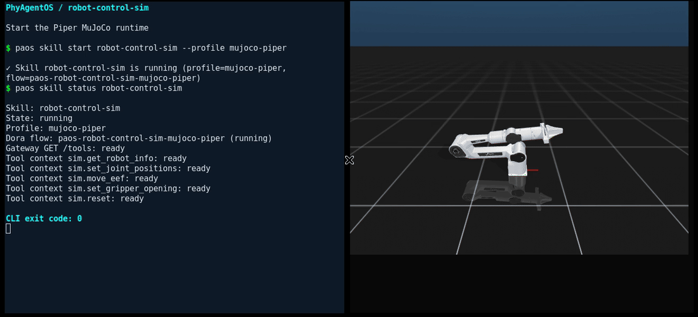
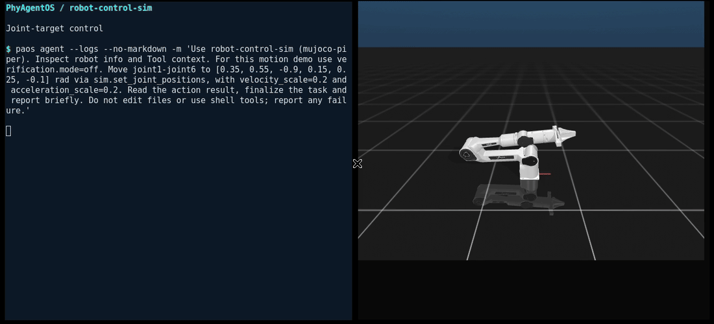
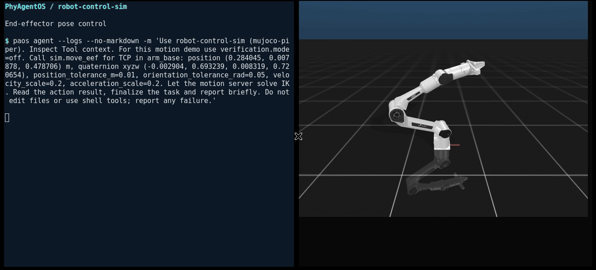

# MuJoCo Quickstart: control a simulated robot

[English](quickstart-mujoco.md) | [简体中文](quickstart-mujoco_zh.md) · [Back to the homepage](../README.md)

> [!TIP]
> **Developers: bring your own robot — [Piper X customization demo](user_development_guide/PIPER_X_DEMO.md).**
> Follow the complete model-to-Skill example for joint and end-effector control. Use the [Skill development manual](user_development_guide/track_b/SKILL_DEVELOPMENT.md) to choose between configuration changes, a new profile and Node development.

Use **`robot-control-sim`** to control a simulated Piper arm through joint targets or
end-effector poses. Complete [PAOS installation and model configuration](../README.md#quick-start) first.
The prebuilt simulation Nodes used here target **Linux x86_64** and require a working
graphical display or virtual display for MuJoCo and the image viewer.

## 1. Install Dora

v1.2.0 retains the Dora CLI **0.4.1** (`dora-message` **0.7.0**) compatibility baseline:

```bash
curl --proto '=https' --tlsv1.2 -LsSf \
  https://github.com/dora-rs/dora/releases/download/v0.4.1/dora-cli-installer.sh | sh
dora --version
```

Dora is required to start the simulation Runtime. See the [Dora installation reference](en/02-user-manual.md#dora-cli-for-managed-skill-profiles) for other installation methods.

## 2. Install robot-control-sim

See the [FAQ](FAQ.md#resource-registry) for the Registry API URL, environment override precedence and download troubleshooting.

Set `resourceRegistry.url` in your config, or `PAOS_RESOURCE_REGISTRY_URL`, to a deployment
that provides `robot-control-sim` and its locked Node artifacts. Then run:

```bash
paos skill search robot-control-sim
paos skill install robot-control-sim
paos skill inspect robot-control-sim
```

`inspect` shows the installed version, profiles and dependencies. This example uses
`mujoco-piper`; `mujoco-franka` and `mujoco-so101` select other robots. For a separately
obtained Bundle, use `paos skill install /path/to/robot-control-sim.tar.gz --local`;
its locked Nodes must also be available. Core does not bundle these simulation assets.

## 3. Start the simulation

```bash
paos skill start robot-control-sim --profile mujoco-piper
paos skill status robot-control-sim
```

Wait for the Runtime to report healthy and the simulation camera viewer to open. If startup
fails, inspect `paos skill logs robot-control-sim` before sending a motion request.



## 4. Control joints and the end effector

The Agent reads `sim.get_robot_info` and live Tool context to determine joints, limits, frames
and units, then follows the active Skill workflow. The absolute targets below are for
`mujoco-piper` (`arm_base` / `tcp`); use the selected robot's frames and reachable targets when switching profiles.

| Control mode | Tool | Target |
| --- | --- | --- |
| Joint targets | `sim.set_joint_positions` | Absolute arm joint positions in radians |
| End-effector pose | `sim.move_eef` | Absolute position in meters and quaternion orientation; the motion server solves IK |

These motion demos use `verification.mode=off`, so success is derived from Tool execution results. For semantic task verification and evidence policies, see the [Core developer manual](en/03-developer-manual.md#7-verification-and-recovery).

Try a joint-space request:

```bash
paos agent -m "Use robot-control-sim (mujoco-piper). Inspect robot info and Tool context. For this \
  motion demo use verification.mode=off. Move joint1-joint6 to [0.35, 0.55, -0.9, 0.15, \
  0.25, -0.1] rad via sim.set_joint_positions, with velocity_scale=0.2 and \
  acceleration_scale=0.2. Read the action result, finalize the task and report briefly. Do \
  not edit files or use shell tools; report any failure."
```



Then try a Cartesian request:

```bash
paos agent -m "Use robot-control-sim (mujoco-piper). Inspect Tool context. For this motion demo use \
  verification.mode=off. Call sim.move_eef for TCP in arm_base: position (0.284045, \
  0.007878, 0.478706) m, quaternion xyzw (-0.002904, 0.693239, 0.008319, 0.720654), \
  position_tolerance_m=0.01, orientation_tolerance_rad=0.05, velocity_scale=0.2, \
  acceleration_scale=0.2. Let the motion server solve IK. Read the action result, finalize \
  the task and report briefly. Do not edit files or use shell tools; report any failure."
```



*Live recordings of the command and MuJoCo simulation; the captured command panel is held visible and model-wait pauses are shortened.*

You can also run `paos agent` for interactive control. Motion should be visible in the simulation;
read the returned execution result and final state rather than treating admission as completion.

## 5. Stop the simulation

After the motion task has finished:

```bash
paos skill stop robot-control-sim
```

Normal stop first reconciles retained execution references in the configured workspace.
Use `paos skill reconcile robot-control-sim --workspace /path/to/workspace` to retry recovery explicitly.
Unconfirmed actions remain protected; `--force` explicitly authorizes runtime termination.
Each runtime generation has a distinct Dora flow name, shown by `paos skill status`.
See [runtime recovery and process ownership](user_development_guide/track_b/RUNTIME.md#runtime-recovery-and-process-ownership) for platform limits.

## Extend this example

- [TrackB framework guide](user_development_guide/track_b/README.md): architecture, repository catalog and Node protocols.
- [Skill development manual](user_development_guide/track_b/SKILL_DEVELOPMENT.md): configure a profile, add a profile, or develop Nodes and assemble a Skill.
- [Piper X development demo](user_development_guide/PIPER_X_DEMO.md): adapt `robot-control-sim` to another arm, including model conversion and both control modes.
- [Bundle and Tool integration reference](user_development_guide/README.md): manifest fields, packaging and local installation.
