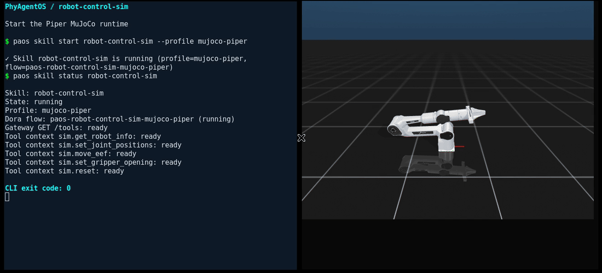
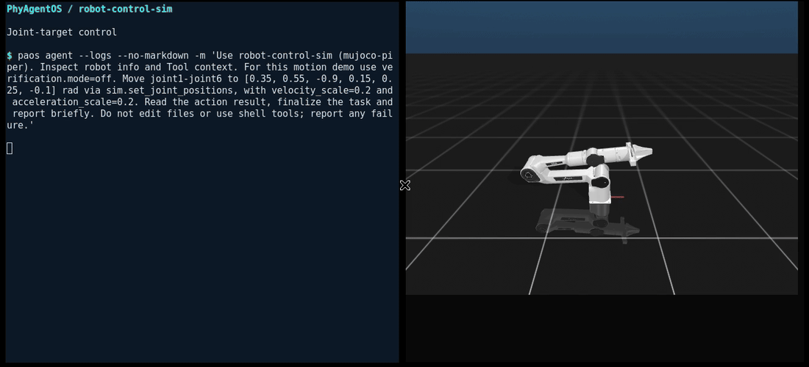
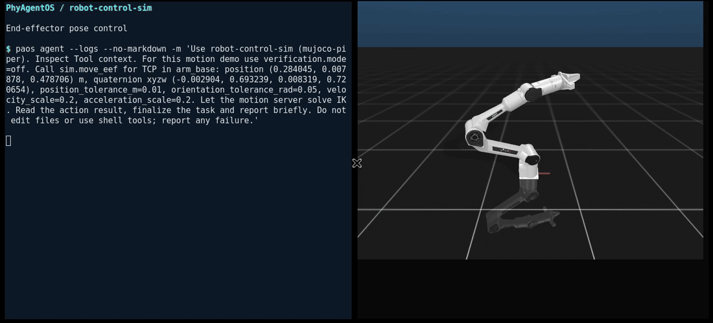

# MuJoCo Quickstart：操控仿真机器人

[English](quickstart-mujoco.md) | [简体中文](quickstart-mujoco_zh.md) · [返回主页](../README_zh.md)

> [!TIP]
> **开发者接入自己的机械臂：直接查看 [Piper X 完整二次开发 demo](user_development_guide/PIPER_X_DEMO_zh.md)。**
> 从模型转换到 Skill 组装，跑通关节与末端位姿控制；配合 [Skill 开发手册](user_development_guide/track_b/SKILL_DEVELOPMENT_zh.md)，选择配置修改、新增 profile 或独立 Node 开发。

以 **`robot-control-sim`** 为例，通过关节目标或末端位姿控制仿真 Piper 机械臂。
请先按[安装与配置](../README_zh.md#quick-start)完成 PAOS 与模型配置。本例使用的预构建仿真 Node 面向 **Linux x86_64**，
MuJoCo 和图像查看器需要可用的图形显示或虚拟显示环境。

## 1. 安装 Dora

v1.2.0 沿用 Dora CLI **0.4.1**（`dora-message` **0.7.0**）兼容基线：

```bash
curl --proto '=https' --tlsv1.2 -LsSf \
  https://github.com/dora-rs/dora/releases/download/v0.4.1/dora-cli-installer.sh | sh
dora --version
```

启动仿真 Runtime 需要 Dora；其他安装方式见 [Dora 安装参考](zh/02-user-manual.md#托管-skill-profile-所需的-dora-cli)。

## 2. 安装 robot-control-sim

资源 API 地址、环境变量优先级及下载排障见 [FAQ](FAQ_zh.md#resource-registry)。

在配置中设置 `resourceRegistry.url`，或通过 `PAOS_RESOURCE_REGISTRY_URL` 指向提供
`robot-control-sim` 及其锁定 Node 制品的部署，再运行：

```bash
paos skill search robot-control-sim
paos skill install robot-control-sim
paos skill inspect robot-control-sim
```

`inspect` 显示已安装版本、profile 与依赖。本例使用 `mujoco-piper`；也可选择
`mujoco-franka` 或 `mujoco-so101` 切换机器人。独立获取的 Bundle 可用
`paos skill install /path/to/robot-control-sim.tar.gz --local` 安装，所锁定的 Node 也需可获取。
Core 不内置这些仿真资源。

## 3. 启动仿真

```bash
paos skill start robot-control-sim --profile mujoco-piper
paos skill status robot-control-sim
```

等待 Runtime 报告健康并打开仿真相机查看器。启动失败时，先通过
`paos skill logs robot-control-sim` 定位问题，再提交运动请求。



## 4. 按关节目标和末端位姿控制

Agent 读取 `sim.get_robot_info` 与实时 Tool context，确认关节、限位、坐标系和单位，
再按活动 Skill 的工作流执行。下方绝对目标适用于 `mujoco-piper`（`arm_base` / `tcp`）；
切换 profile 时应使用对应机器人的坐标系和可达目标。

| 控制方式 | Tool | 目标 |
| --- | --- | --- |
| 关节目标 | `sim.set_joint_positions` | 机械臂各关节的绝对位置，单位为弧度 |
| 末端位姿 | `sim.move_eef` | 以米表示的绝对位置及四元数姿态，由 motion server 求解 IK |

运动演示使用 `verification.mode=off`，按 Tool 执行结果判断完成；语义任务验证与证据策略见 [Core 开发者手册](zh/03-developer-manual.md#7-verification-与-recovery)。

先尝试关节空间请求：

```bash
paos agent -m "使用 robot-control-sim 的 mujoco-piper。 \
  检查机器人信息和 Tool context，本次运动演示使用 verification.mode=off。 \
  通过 sim.set_joint_positions 将 joint1-joint6 移动到 [0.35, 0.55, -0.9, 0.15, 0.25, -0.1] rad， \
  velocity_scale 和 acceleration_scale 均为 0.2。 \
  读取动作结果、finalize 任务并简要报告。 \
  不修改文件、不使用 shell 工具；失败时直接报告。"
```



再尝试末端位姿请求：

```bash
paos agent -m "使用 robot-control-sim 的 mujoco-piper。 \
  检查 Tool context，本次运动演示使用 verification.mode=off。 \
  调用 sim.move_eef，将 TCP 移到 arm_base 下的位置 (0.284045, 0.007878, 0.478706) m， \
  四元数 xyzw 为 (-0.002904, 0.693239, 0.008319, 0.720654)， \
  position_tolerance_m=0.01、orientation_tolerance_rad=0.05， \
  velocity_scale 和 acceleration_scale 均为 0.2。 \
  由 motion server 求解 IK；读取动作结果、finalize 任务并简要报告。 \
  不修改文件、不使用 shell 工具；失败时直接报告。"
```



*以上为命令与 MuJoCo 仿真的运行实录，命令画面固定保留以便阅读，并已缩短模型等待停顿。*

也可运行 `paos agent` 进入交互控制。应能在仿真中观察到运动；以返回的执行结果和最终状态为准，
不把请求已接纳当作动作已完成。

## 5. 停止仿真

运动任务结束后执行：

```bash
paos skill stop robot-control-sim
```

普通停止会先根据配置的工作区恢复保留的执行引用。
也可使用 `paos skill reconcile robot-control-sim --workspace /path/to/workspace` 显式重试恢复。
无法确认终态的动作仍受保护；`--force` 表示明确授权终止 runtime。
每轮 runtime 使用独立的 Dora flow 名称，可通过 `paos skill status` 查看。
平台限制见[运行恢复与进程归属](user_development_guide/track_b/RUNTIME_zh.md#运行恢复与进程归属)。

## 在此基础上二次开发

- [TrackB 框架说明](user_development_guide/track_b/README_zh.md)：整体架构、仓库目录与节点协议。
- [Skill 开发手册](user_development_guide/track_b/SKILL_DEVELOPMENT_zh.md)：修改 profile、增加 profile，以及独立开发 Node 并组装 Skill。
- [Piper X 二次开发 demo](user_development_guide/PIPER_X_DEMO_zh.md)：为 `robot-control-sim` 接入另一种机械臂，包含模型转换与两种控制方式。
- [Bundle 与 Tool 接入参考](user_development_guide/README_zh.md)：manifest 字段、打包和本地安装。
