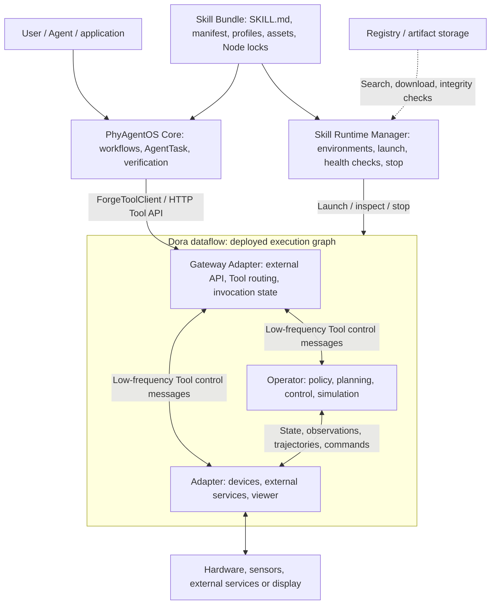

# TrackB Framework Guide

[English](README.md) | [简体中文](README_zh.md)

[Overview](README.md) · [Repositories](REPOSITORIES.md) · [Protocols](PROTOCOLS.md) · [Runtime](RUNTIME.md) · [Skill development](SKILL_DEVELOPMENT.md)

[Bundle and Tool integration reference](../README.md) · [Piper X tutorial](../PIPER_X_DEMO.md) · [Documentation index](../../README.md)

**Platform availability:** External resource submissions and changes to existing registered repositories are not yet open. They must wait for the approval service to be completed and opened. Current registration/publication is administrator-managed. Local development and validation can proceed; platform publication steps below are conditional on that workflow becoming available. See the [contribution guide](../../../CONTRIBUTING.md).

## 1. Scope and reading path

TrackB here means the robotics execution framework built on Forge and Dora and deployed through Skill Bundles.
Forge supplies common messages, interfaces and Node foundations; Dora hosts processes/dataflows;
PhyAgentOS Core organizes deployment and task workflows through Skills and invokes Node capabilities through Gateway.

| Document | Questions answered |
| --- | --- |
| This overview | Layer responsibilities, code organization, Node categories and version boundaries |
| [Repository catalog](REPOSITORIES.md) | Source locations and responsibilities of framework, Adapter, Operator and benchmark repositories |
| [Protocols and important Node types](PROTOCOLS.md) | Robot/Sensor/Policy/Motion messages, ports, units and Endpoint contracts |
| [Skill, Tool, Endpoint, Gateway and Runtime](RUNTIME.md) | Logical relationships and robot-control-sim 0.1.2 configuration, routing and execution |
| [Skill development manual](SKILL_DEVELOPMENT.md) | Procedures and difficulty for configuration changes, new profiles and independent Node development |

To integrate another robot already supported by existing Nodes, read the first two development modes,
then follow the [Piper X demo](../PIPER_X_DEMO.md) for model/configuration work and native Action validation.
For a new driver, algorithm or Tool capability, examine protocols/source before using mode three.

## 2. Overall architecture

Registry distributes resources; it is not involved in every robot command. The selected profile's dataflow
connects models, cameras, IK and controllers. Operator/Adapter boxes are categories, not mandatory components
of every Skill. MuJoCo is a Simulator Operator and can produce state without a hardware Adapter.

## 3. Code layers

| Layer | Main code / configuration | Responsibility |
| --- | --- | --- |
| Agent and Skill lifecycle | Core `forge/`, `skill_runtime/`, `SKILL.md` | Workflows, task binding/verification, deployment environments and runtime state |
| Skill assembly | `skill.yaml`, `profiles/<name>/`, `assets/` | Robot, Nodes, Tools, models, connections and parameters |
| External boundaries | `adapter-forge-gateway`, device/viewer Adapters | External calls, protocol translation and resource lifecycle |
| Graph computation/execution | `operator-*` | Policy, motion planning, trajectory control, simulation |
| Shared framework | `forge` | Common, Msgs, Robot, Policy, Kinematics and Tool families |
| Dataflow runtime | Dora | Launch Nodes and forward typed port data/events |

Repositories, Nodes, Endpoints and Tools are not one-to-one. A repository may publish several Nodes;
a Node may implement multiple Endpoints/operations or handle data only. A Skill may reuse Nodes from
several repositories, and the same immutable Node artifact may be locked by multiple Skills/profiles.
See [Runtime relationships](RUNTIME.md).

## 4. Adapter and Operator

- **Adapter:** owns an external device/service/runtime/caller boundary, translates protocols and manages resources. Robot, Camera, Gateway and Viewer are examples.
- **Operator:** computes policy, planning, control, perception or simulation using Forge messages as its main boundary.
- Classification follows primary responsibility, not input/output direction; either category may expose ToolEndpoint.
- `ToolEndpoint` is a capability interface; `PolicyAdapter` names a policy plugin interface. Neither adds a third Node category.
- External Agent/web clients are outside the Dora Node taxonomy.

Definition: [Forge Node Model](https://github.com/PhyAgentOS/forge/blob/e59693910bb5f9572cf39c5a59475c0747ba76e8/README.md).

## 5. Architecture, versions and source snapshots

Logical architecture describes stable responsibilities/relationships. Actual capabilities must be checked
against compatible Gateway, provider, Core and artifact versions.

| Scope | Version basis | Usage |
| --- | --- | --- |
| Forge source snapshot | Dora 1.x / Forge 2.x; Common 2.1.0, other five families 2.0.0 | Pin commits/locks; do not automatically replace older Nodes |
| Forge maintenance line | `stable/1.x`, Dora 0.4 compatibility | Still verify exact tags/commits for old Nodes |
| Current Core release | Core v1.1.1 | See the [changelog](../../../CHANGELOG.md) |
| Recorded runtime example | Core v1.1.0, Dora CLI 0.4.1, robot-control-sim 0.1.2 | Interpret behavior using the original locked artifacts |
| Piper X demo | Model, profile and workflow changes on that baseline | Preserve nine Node locks; no protocol upgrade |

Public source and binary provenance are separate requirements. The catalog's source snapshot does not
prove how an older Release binary was built. See [independent Node development](SKILL_DEVELOPMENT.md#4-mode-three-develop-nodes-and-assemble-a-skill)
for modification, build, archive and provenance requirements.

Twenty code repositories are now under PhyAgentOS; organization configuration `.github` remains under
Forgelab-Robotics. See the [catalog](REPOSITORIES.md) for locations and post-transfer maintenance.
