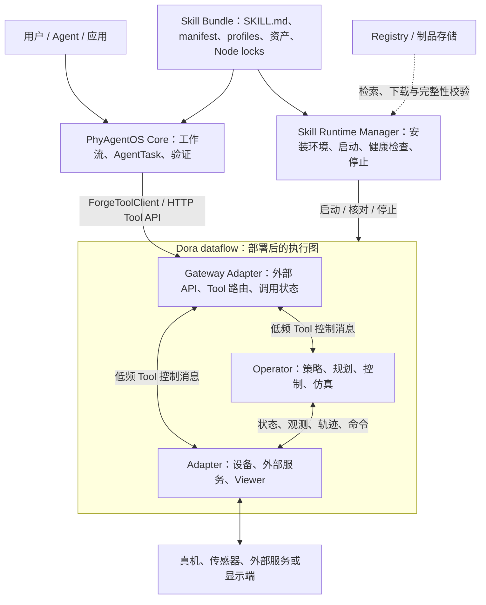

# TrackB 框架说明

[English](README.md) | [简体中文](README_zh.md)

[整体架构](README_zh.md) · [仓库目录](REPOSITORIES_zh.md) · [公共协议](PROTOCOLS_zh.md) · [Runtime 关系](RUNTIME_zh.md) · [Skill 开发](SKILL_DEVELOPMENT_zh.md)

[Bundle 与 Tool 接入参考](../README_zh.md) · [Piper X 完整示例](../PIPER_X_DEMO_zh.md) · [文档索引](../../README_zh.md)

**平台开放范围：** 外部贡献提交及已有登记仓库修改暂未开放，需等待审批服务完成并开放。当前登记与发布由管理员维护；可先进行本地开发验证。下文的平台发布步骤以相关流程开放为前提，详见[贡献指南](../../../CONTRIBUTING_zh.md)。

## 1. 框架范围与阅读路径

本文将基于 Forge 和 Dora、由 Skill Bundle 配置部署的机器人执行框架称为 TrackB。
Forge 提供公共消息、接口和节点实现基础；Dora 承载进程与数据流；PhyAgentOS Core 使用 Skill
组织部署与任务工作流，并经 Gateway 调用节点能力。

| 文档 | 解决的问题 |
| --- | --- |
| 本文：整体架构 | 各层职责、代码组成、节点分类与版本边界 |
| [仓库目录](REPOSITORIES_zh.md) | 基础库、Adapter、Operator、benchmark 的源码位置和职责 |
| [公共协议与重要节点类型](PROTOCOLS_zh.md) | Robot/Sensor/Policy/Motion 消息、端口、单位及 Endpoint 契约 |
| [Skill、Tool、Endpoint、Gateway 与 Runtime](RUNTIME_zh.md) | 理论关系与 robot-control-sim 0.1.2 的实际配置、路由、执行链 |
| [Skill 开发手册](SKILL_DEVELOPMENT_zh.md) | 修改原 profile、新增 profile、独立 Node 开发三种模式的流程与难度 |

只想接入现有节点支持的新机器人时，先阅读 Skill 开发手册的前两种模式，再跟随
[Piper X demo](../PIPER_X_DEMO_zh.md)完成模型、配置和原生 Action 验收。
需要新增设备驱动、算法或 Tool 能力时，先查协议和源码，再进入第三种模式。

## 2. 整体架构

图中 Registry 属于资源分发阶段，不参与每一条机器人命令。模型、相机、IK 和控制器的连接由
选定 profile 的 dataflow 决定；图中的 Operator/Adapter 方框代表类别，并不要求每个 Skill 包含所有类别。
MuJoCo 在当前分类中属于 Simulator Operator，本身可以产生仿真状态，无需一个真机 Adapter。

## 3. 代码按什么层次组成

| 层次 | 主要代码 / 配置 | 职责 |
| --- | --- | --- |
| Agent 与 Skill 生命周期 | Core 的 `forge/`、`skill_runtime/`、`SKILL.md` | 工作流、任务绑定与验证、部署环境与运行状态 |
| Skill 组装 | `skill.yaml`、`profiles/<name>/`、`assets/` | 选择机器人、节点、Tool、模型、连接与参数 |
| 外部访问边界 | `adapter-forge-gateway`、设备和 Viewer Adapter | 外部调用、协议转换与资源生命周期 |
| 图内计算与执行 | `operator-*` | 策略、运动规划、轨迹控制、仿真等节点实现 |
| 公共框架 | `forge` | Common、Msgs、Robot、Policy、Kinematics、Tool 六个家族 |
| 数据流运行底座 | Dora | 按 dataflow 启动节点，转发有类型的端口数据和事件 |

仓库、Node、Endpoint、Tool 不是一一对应关系。一个仓库可以发布多个 Node；一个 Node 可以实现
多个 Endpoint/operation，也可以只处理数据而不暴露 Endpoint。一个 Skill 可以复用多个仓库的 Node，
相同 Node 制品也可以被多个 Skill/profile 锁定。详见 [Runtime 关系](RUNTIME_zh.md)。

## 4. Adapter 与 Operator

- **Adapter（对外边界）**：与外部设备、服务、运行时或调用者通信，转换协议并管理资源生命周期。
  Robot、Camera、Gateway、Viewer 属于这一侧。
- **Operator（图内计算）**：以 Forge 消息为主要输入/输出，进行策略、规划、控制、感知或仿真计算。
- 分类依据主要职责，不依据输入/输出方向；两类节点都可以暴露 ToolEndpoint。
- `ToolEndpoint` 是能力接口；`PolicyAdapter` 是策略插件接口名，均不额外构成节点大类。
- 外部 Agent/Web 客户端不属于 Dora 节点分类。

定义依据：[Forge Node Model](https://github.com/PhyAgentOS/forge/blob/e59693910bb5f9572cf39c5a59475c0747ba76e8/README.md)。

## 5. 理论边界、实现版本与源码快照

“理论架构”描述稳定职责和连接关系；实际功能必须按 Gateway、provider、Core 和制品版本共同核对。

| 范围 | 版本依据 | 使用方式 |
| --- | --- | --- |
| Forge 源码快照 | Dora 1.x / Forge 2.x；Common 2.1.0，其余五家族 2.0.0 | 以固定提交和依赖锁为准，不自动替代旧 Node |
| Forge 维护线 | `stable/1.x`，Dora 0.4 兼容线 | 旧节点维护仍需核对具体 tag/commit |
| 当前 Core 发布版本 | Core v1.1.1 | 参见 [更新记录](../../../CHANGELOG.md) |
| 本组历史运行示例 | Core v1.1.0、Dora CLI 0.4.1、robot-control-sim 0.1.2 | 依照原 Skill 锁定的制品解释行为 |
| Piper X demo | 在上行基线上修改模型、profile 和工作流 | 保留九个 Node locks，未进行协议升级 |

代码已开源和二进制可追溯是不同的交付条件；索引中的最新源码不证明某个旧 Release 二进制由它构建。
Node 修改、构建、归档和溯源要求见 [独立 Node 开发](SKILL_DEVELOPMENT_zh.md#4-模式三独立开发-node-并组装自己的-skill)。

20 个代码仓库已迁入 PhyAgentOS；组织配置 `.github` 保留在 Forgelab-Robotics。
完整目录和迁移后的维护约束见 [仓库目录](REPOSITORIES_zh.md)。
