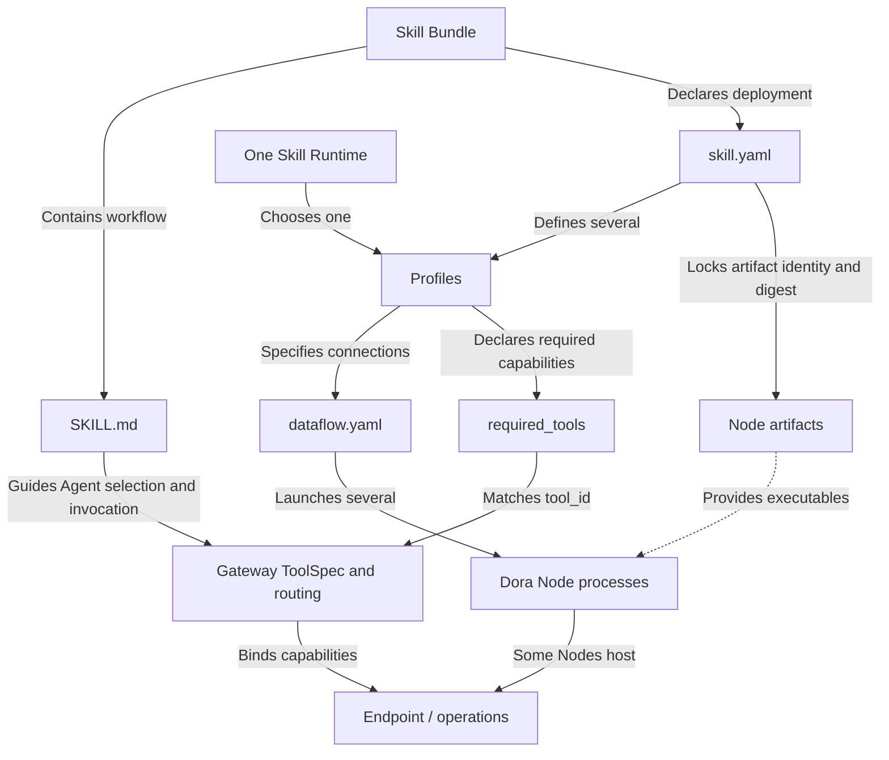
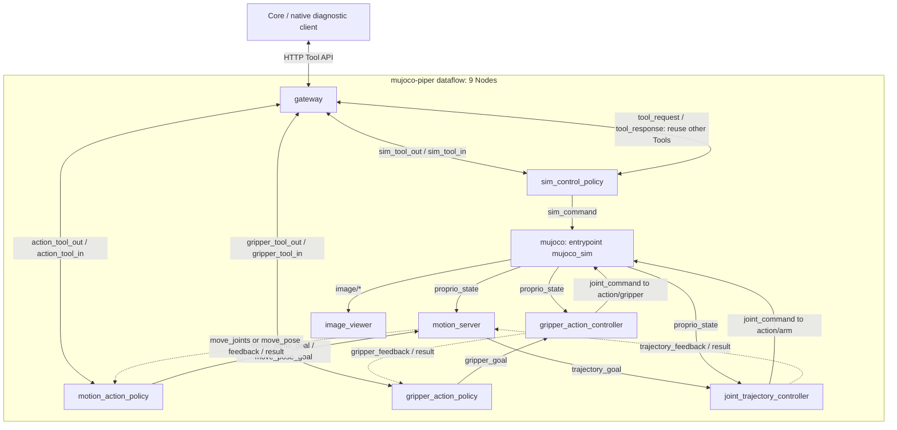
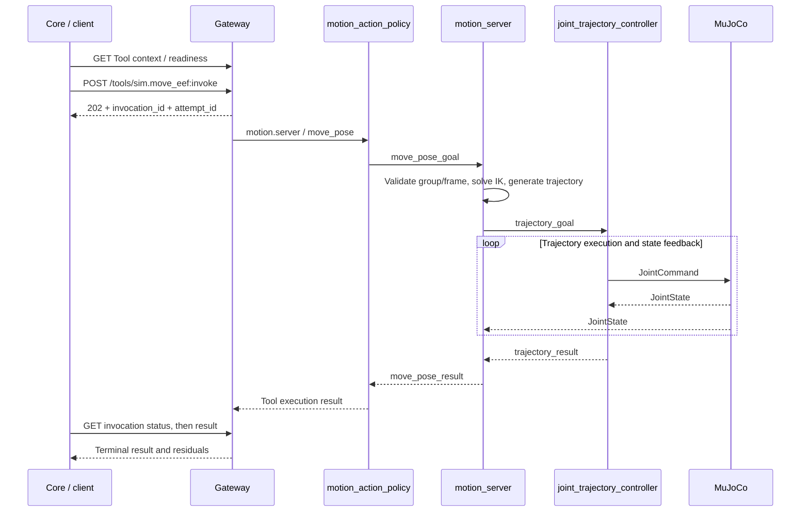

# TrackB Runtime: Skill, Tool, Endpoint and Gateway

[English](RUNTIME.md) | [简体中文](RUNTIME_zh.md)

[Overview](README.md) · [Repositories](REPOSITORIES.md) · [Protocols](PROTOCOLS.md) · [Runtime](RUNTIME.md) · [Skill development](SKILL_DEVELOPMENT.md)

This page explains logical responsibilities, then the public robot-control-sim 0.1.2 `mujoco-piper` deployment.
This guide targets Core v1.1.1; the recorded example uses Core v1.1.0, Dora CLI 0.4.1 and original Node locks. See the
[overview](README.md#5-architecture-versions-and-source-snapshots) for source/binary version boundaries.

## 1. Three meanings of Runtime

| Name | Layer / implementation | Managed concerns |
| --- | --- | --- |
| Skill Runtime | Core `RuntimeManager`, runtime environment, `RuntimeState` | Profile choice, artifact verification, Dora launch, readiness and stop |
| Tool Runtime | Logical responsibility usually hosted by Gateway | Tool catalog, implementation selection, invocation/attempt, status/results |
| Node / Dora runtime | Dora and Node processes | Port traffic, compute loops, device/simulator lifecycles |

Tool Runtime does not require another process named runtime; Skill Runtime is not a control algorithm.
AgentTask manages goals, bindings, evidence and verdicts without replacing Gateway/provider execution facts.

## 2. Logical architecture and relationships

### 2.1 From Agent to executor

```mermaid
flowchart LR
    A["External Agent / application"]
    C["Core: Skill workflows and AgentTask"]
    subgraph G["Gateway Adapter"]
        API["Caller API"]
        CAT["Logical ToolSpec catalog"]
        RT["Tool Runtime: invocation and implementation selection"]
        ROUTER["Endpoint Registry and routing"]
        API --> CAT
        API --> RT
        CAT --> RT
        RT --> ROUTER
    end
    subgraph P["Provider: Operator or Adapter Node"]
        B["Carrier binding / Endpoint handler"]
        E["ToolEndpoint operation"]
        X["Algorithm, device or downstream Action execution"]
        B --> E --> X
    end
    A --> C
    C <-->|"HTTP Tool API"| API
    ROUTER <-->|"Low-frequency Endpoint Wire"| B
    X <-->|"State, observations, commands, trajectories"| DATA["Dora data plane"]
```



A Tool is a stable caller-facing capability; Gateway bindings select an implementation and Endpoint operation.
Endpoint is the provider's logical capability boundary, not an HTTP server, process name or repository.
Caller HTTP and provider Wire are separate edges and need not share formats/fields.

This diagram expresses responsibilities, not complete implementation by every published Gateway.
The worked version uses Action `/tools/{tool_id}:invoke` and Query `/tools/{endpoint_id}/{operation}:invoke`,
retaining Endpoint-directed Query URLs. Use the matching [Core Tool API contract](../../forge/README.md);
do not describe the goal of hidden provider routing as functionality already present in every older API.

Architecture: [Forge Tool architecture](https://github.com/PhyAgentOS/forge/blob/e59693910bb5f9572cf39c5a59475c0747ba76e8/interfaces/forge_tool/ARCHITECTURE.md).

### 2.2 Definitions, deployment and capabilities



| Object | Role | Example location |
| --- | --- | --- |
| Skill workflow | When to use capabilities, what to query and how to decide completion | `SKILL.md` |
| Skill Bundle | Versioned deployment of workflow, profiles, models and dependency locks | `skill.yaml`, `profiles/`, `assets/` |
| Profile | Robot, connections, parameters and environment within a Bundle | `profiles/mujoco-piper/` |
| Tool / ToolSpec | Caller-visible ID, semantics, schemas, frames, readiness | `tools.specs` in `gateway.yaml` |
| Endpoint operation | Provider query/start/status/result/cancel contract | Endpoint ID + operation + matching implementation |
| Provider | Node hosting the Endpoint | motion/gripper/sim control policy |
| Gateway | HTTP boundary, ToolSpec, provider routing and invocation state | `gateway` Node |
| Dataflow | Node IDs, executable entrypoints, configuration and port connections | `dataflow.yaml` |

An Endpoint may have multiple operations and multiple Tool bindings. Controllers, simulators and viewers
may participate only in the data plane. Repository, binary entrypoint, Dora Node ID, Tool ID and Endpoint ID
are different identities; do not infer one-to-one mapping from matching strings.

Core `forge_tool_start_action` and related tools are generic Agent wrappers;
`sim.move_eef` is a Skill's concrete Tool ID; `SKILL.md` is workflow documentation.
These are three different concepts.

## 3. Creating a Skill Runtime

1. Acquire/validate the Skill Bundle and locked Node artifacts; install manifest/assets.
2. Select a profile, prepare binary environments, materialize launch dataflow and configuration/asset references.
3. `RuntimeManager` checks Dora, binaries, assets, environment and Gateway address, running Bundle `start.sh` when needed.
4. Launch Dora with placeholders such as `${FORGE_RUNTIME_BIN}` bound to that environment.
5. Inspect flow, Gateway and profile Tool context/readiness; record runtime state and Gateway identity.
6. Activate workflow and create a bound task; recheck Skill/profile, Runtime identity, ToolSpec, allowlist and readiness when invoking.
7. Stop according to active invocation/task binding rules; accepted cancellation does not prove execution has stopped.

When present, `profiles.<name>.required_tools` overrides the top-level list for readiness and frozen task Tool allowlists.
The same Skill name does not imply identical Tools across profiles. Core stores current RuntimeState per installed Skill;
multiple profile definitions do not imply concurrent profiles for one Skill. Stop before switching and resolve
port, device and display contention separately.

Runtime and invocation identities are also layered:

| Identity | Meaning |
| --- | --- |
| `runtime_instance_id` | This Core Skill Runtime instance |
| `gateway_identity` | Bound Gateway service identity |
| `endpoint_instance_id` | Provider registration instance, not static Endpoint ID |
| `invocation_id` | Logical Gateway invocation |
| `attempt_id` | Provider execution attempt |

Task, Runtime, Gateway and provider identities are not interchangeable. An Endpoint with the same name
after provider restart is not automatically the original execution instance.

Implementation:
[environment materialization](../../../PhyAgentOS/skill_runtime/installer.py),
[RuntimeManager](../../../PhyAgentOS/skill_runtime/manager.py),
[manifest/profiles](../../../PhyAgentOS/skill_runtime/manifest.py),
[RuntimeState](../../../PhyAgentOS/skill_runtime/state.py),
[task binding](../../../PhyAgentOS/forge/binding.py).

## 4. Actual robot-control-sim assembly

### 4.1 Configuration files

Inspect the validated robot-control-sim 0.1.2 Bundle:

```text
robot-control-sim/
├── SKILL.md
├── skill.yaml
├── profiles/mujoco-piper/
│   ├── dataflow.yaml
│   ├── gateway.yaml
│   ├── sim_control_policy.yaml
│   ├── motion_server.yaml
│   ├── controller.yaml
│   ├── gripper_controller.yaml
│   ├── simulator.yaml
│   └── image_viewer.yaml
└── assets/robots/piper/...
```

`skill.yaml` locks nine Nodes. `mujoco-piper` requires nine binaries and Gateway
`http://127.0.0.1:19002`, exposing five Tools rather than the top-level minimal two.
`mujoco-franka` also exposes five; `mujoco-so101` omits `sim.set_gripper_opening` and runs seven Nodes.
Nine artifact locks do not imply nine running processes in every profile.

Piper X uses separate profile `mujoco-piper-x` and port `19104`; do not mix its group/frames with original Piper.
See [PIPER_X_DEMO.md](../PIPER_X_DEMO.md).

### 4.2 Five Tools, three Endpoints, three providers

| Tool ID | Semantics | implementation_id | Endpoint / operation | Actual provider Node |
| --- | --- | --- | --- | --- |
| `sim.get_robot_info` | query | `sim.control` | `sim.control` / `get_robot_info` | `sim_control_policy` |
| `sim.set_joint_positions` | action | `motion.integration` | `motion.server` / `move_joints` | `motion_action_policy` |
| `sim.move_eef` | action | `motion.integration` | `motion.server` / `move_pose` | `motion_action_policy` |
| `sim.set_gripper_opening` | action | `piper.gripper` | `gripper.controller` / `set_opening` | `gripper_action_policy` |
| `sim.reset` | action | `sim.control` | `sim.control` / `reset` | `sim_control_policy` |

`motion.server` is a logical Endpoint ID. Gateway first routes to `motion_action_policy`,
not directly to the compute Node `motion_server`. `implementation_id` is not an executable filename either.

The actual `gateway.yaml` provider routes are:

```yaml
tools:
  providers:
    - endpoint_id: sim.control
      input_id: sim_tool_in
      output_id: sim_tool_out
    - endpoint_id: motion.server
      input_id: action_tool_in
      output_id: action_tool_out
    - endpoint_id: gripper.controller
      input_id: gripper_tool_in
      output_id: gripper_tool_out
```

Inputs/outputs below are named from Gateway's perspective; dataflow chooses the peer:

```yaml
# Excerpt of dataflow.yaml, not an independently runnable graph.
nodes:
  - id: gateway
    inputs:
      action_tool_in: motion_action_policy/tool_out
    outputs: [action_tool_out]
  - id: motion_action_policy
    inputs:
      tool_in: gateway/action_tool_out
    outputs: [tool_out]
```

### 4.3 Execution and state feedback



Timers/cancel ports are omitted; main command/state/result directions are shown. Joint and end-effector
modes share motion server -> trajectory controller -> MuJoCo; the entry operation and URDF IK step differ.
Images flow directly to Viewer, outside HTTP Tool requests.

`sim.reset` does not write simulator state directly from Core. Sim-control policy uses `sim_command`
and reuses Motion/Gripper Tools over `tool_request/tool_response` to restore the initial pose as configured.
Sending reset and successfully re-homing are different events.

### 4.4 One end-effector invocation



Gateway admission and provider dispatch are asynchronous; HTTP 202 does not mean arrival.
Native diagnostics wait for `phase=completed`, then inspect `data.result.status=succeeded`,
motion `error_code=SUCCESS` and position/orientation residuals. AgentTask adds independent verification
and verdicts: execution success alone is not task verification success. Timeout, accepted cancel or unknown
must not trigger blind motion resubmission.

Original Piper uses group `piper_arm`, reference frame `arm_base`, target frame `tcp`.
Query `sim.get_robot_info` and Tool context first; do not substitute Piper X `piper_x_arm` / `base_link`.

## 5. Following configuration into source

| Responsibility | Implementation |
| --- | --- |
| Gateway HTTP/provider routing | [adapter-forge-gateway](https://github.com/PhyAgentOS/adapter-forge-gateway/blob/5aaa9d16aff1c1b689dbb53acbcdef406dcb8d97/README.md) |
| Motion Tool provider and compute Node | [policy_nodes.py](https://github.com/PhyAgentOS/operator-motion/blob/24c8a430715f697eea8431bf169c21b8cbb5eb92/packages/motion_server/src/forge_motion_server/policy_nodes.py), [server.py](https://github.com/PhyAgentOS/operator-motion/blob/24c8a430715f697eea8431bf169c21b8cbb5eb92/packages/motion_server/src/forge_motion_server/server.py) |
| Simulation descriptor/reset orchestration | [sim-control runner](https://github.com/PhyAgentOS/operator-sim-control-policy/blob/85679a4be8953e9071de426c7c0973155121d96f/src/sim_control_policy_node/runner.py) |
| Gripper Tool provider | [gripper_action_policy runner](https://github.com/PhyAgentOS/operator-gripper-action-policy/blob/bb69223497b944dd1a0f6fe9ecb36486168a8cc4/src/gripper_action_policy_node/runner.py) |
| Controllers, simulator, viewer | [Node source mapping](REPOSITORIES.md#3-robot-control-sim-node-to-source-mapping) |
| Core HTTP client and Agent wrappers | [ForgeToolClient](../../../PhyAgentOS/forge/tool_client.py), [Agent tools](../../../PhyAgentOS/agent/tools/forge_tool_api.py) |

This table locates responsibilities; Release/build provenance must establish any source-to-historical-binary mapping.
For Node publication and Skill lock updates, see the [development manual](SKILL_DEVELOPMENT.md).
