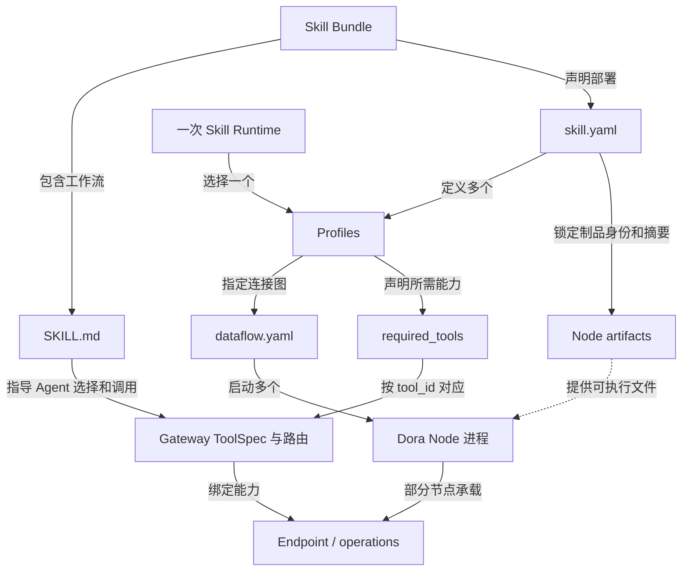
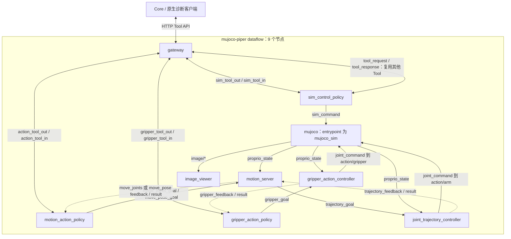
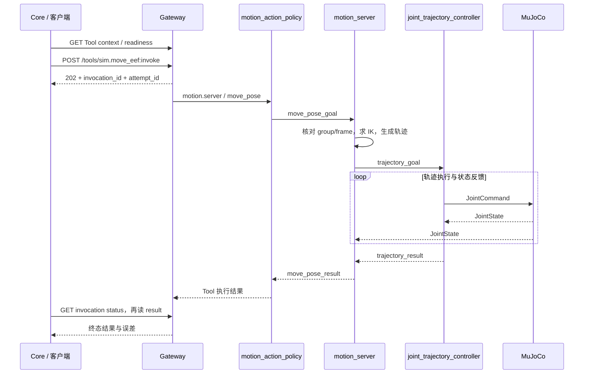

# TrackB Runtime：Skill、Tool、Endpoint 与 Gateway

[English](RUNTIME.md) | [简体中文](RUNTIME_zh.md)

[整体架构](README_zh.md) · [仓库目录](REPOSITORIES_zh.md) · [公共协议](PROTOCOLS_zh.md) · [Runtime 关系](RUNTIME_zh.md) · [Skill 开发](SKILL_DEVELOPMENT_zh.md)

本文先说明逻辑职责，再按公开 `robot-control-sim` 0.1.2 的 `mujoco-piper` profile 解释实际组装。
本指南面向 Core v1.1.1；历史实例使用 Core v1.1.0、Dora CLI 0.4.1 及原始 Node locks；最新 Forge 源码与旧二进制的版本边界见
[总览](README_zh.md#5-理论边界实现版本与源码快照)。

## 1. 先区分三个 Runtime 含义

| 名称 | 所属层 / 实现位置 | 管理什么 |
| --- | --- | --- |
| Skill Runtime | Core 的 `RuntimeManager`、运行环境和 `RuntimeState` | 选 profile、核对制品、启动 Dora flow、等待就绪和停止 |
| Tool Runtime | 通常由 Gateway 承载的逻辑职责 | Tool 目录、实现选择、invocation/attempt、状态与结果 |
| Node / Dora 运行环境 | Dora 和各节点进程 | 端口收发、计算循环、设备/模拟器生命周期 |

Tool Runtime 不要求另起一个叫 runtime 的进程；Skill Runtime 也不是一个控制算法。
Core 任务层的 AgentTask 管理目标、绑定、证据和 verdict，不替代 Gateway/provider 的执行事实。

## 2. 理论架构与对象关系

### 2.1 从 Agent 到执行者的逻辑边界


理论上，Tool 是对调用者稳定的能力入口，Gateway 的内部绑定把它映射到实现与 Endpoint operation。
Endpoint 是 provider 提供能力的逻辑边界，不等于 HTTP 服务、进程名或源码仓库。
外部调用协议与 provider Wire 是两条边；它们不要求使用相同数据格式或字段。

本图描述职责，不承诺每个已发布 Gateway 版本都完整实现目标架构。
本例实际 API 为 Action 的 `/tools/{tool_id}:invoke` 和 Query 的
`/tools/{endpoint_id}/{operation}:invoke`，仍保留 Endpoint 定向的 Query 路径。
应按匹配版本的 [Core Tool API 契约](../../forge/README_zh.md) 调用，
不把“隐藏 provider 路由”的目标边界误写成旧 API 已具备的全部行为。

架构依据：[Forge Tool architecture](https://github.com/PhyAgentOS/forge/blob/e59693910bb5f9572cf39c5a59475c0747ba76e8/interfaces/forge_tool/ARCHITECTURE.md)。

### 2.2 定义、部署和能力之间的关系



| 对象 | 作用 | 本例位置 |
| --- | --- | --- |
| Skill 工作流 | 告诉 Agent 何时使用能力、先查什么、如何判断完成 | `SKILL.md` |
| Skill Bundle | 把工作流、profile、模型和依赖锁作为版本化部署单元 | `skill.yaml`、`profiles/`、`assets/` |
| Profile | 同一 Bundle 下的一组机器人、连接、参数和环境选择 | `profiles/mujoco-piper/` |
| Tool / ToolSpec | 调用者可见的能力名、语义、schema、frame 和 readiness | `gateway.yaml` 中 `tools.specs` |
| Endpoint operation | provider 实现的 query/start/status/result/cancel 等契约 | Endpoint ID + operation + 匹配版本实现 |
| Provider | 实际承载 Endpoint 的节点 | motion/gripper/sim control policy |
| Gateway | HTTP 边界、ToolSpec、provider 路由与调用状态 | `gateway` 节点 |
| Dataflow | 节点 ID、可执行入口、配置文件及端口连接 | `dataflow.yaml` |

一个 Endpoint 可以有多个 operation，多个 Tool 可以映射到它。并非每个 Node 都需要暴露 Endpoint；
控制器、模拟器和 Viewer 可以只参与数据平面。仓库、二进制 entrypoint、Dora node ID、Tool ID 和 Endpoint ID
分别承担不同身份，不能按同名字符串猜测一一对应关系。

Core 的 `forge_tool_start_action` 等工具是通用 Agent wrapper；`sim.move_eef` 等是该 Skill 暴露的
具体 Tool ID；`SKILL.md` 是工作流文档。这三者也不能混为同一种“工具”。

## 3. 一个 Skill Runtime 如何产生

1. 获取并校验 Skill Bundle 和其锁定的 Node 制品，安装清单与资产。
2. 选择 profile，准备所需 binary 的运行环境，物化 launch dataflow 和配置/资产引用。
3. `RuntimeManager` 检查 Dora、binary、资产、环境及 Gateway 地址，按需运行 Bundle 的 `start.sh`。
4. 启动 Dora flow，使 `${FORGE_RUNTIME_BIN}` 等占位符指向该运行环境。
5. 核对 flow、Gateway 以及该 profile 的 Tool context/readiness，随后记录运行状态和 Gateway 身份。
6. Agent 激活工作流并创建绑定任务；调用时复核 Skill/profile、Runtime 身份、ToolSpec、allowlist 和 readiness。
7. 停止时按该 Runtime 的活动调用与任务绑定规则处理，不把取消已受理当作执行已停止。

`profiles.<name>.required_tools` 若存在，会覆盖 Skill 顶层列表，既用于就绪检查，也影响冻结的任务 Tool allowlist。
因此“同一 Skill 名称”不表示“所有 profile 暴露相同工具”。当前 Core 为每个已安装 Skill 保存当前 RuntimeState；
不要从“可定义多个 profile”推断它支持同一 Skill 的多 profile 并发。切换前先停止当前 Runtime，
并分别解决端口、设备和显示资源占用。

运行与调用身份也分层管理：

| Identity | 含义 |
| --- | --- |
| `runtime_instance_id` | Core 本次 Skill Runtime 实例 |
| `gateway_identity` | 绑定到的 Gateway 服务身份 |
| `endpoint_instance_id` | provider 注册实例，不是静态 Endpoint ID |
| `invocation_id` | Gateway 逻辑调用 |
| `attempt_id` | 对 provider 的一次执行尝试 |

Task、Runtime、Gateway 和 provider 的身份不能互相替代；provider 重启后的同名 Endpoint
不能仅凭字符串相同就被认作原来的执行实例。

实现入口：
[环境物化](../../../PhyAgentOS/skill_runtime/installer.py)、
[RuntimeManager](../../../PhyAgentOS/skill_runtime/manager.py)、
[manifest 与 profile](../../../PhyAgentOS/skill_runtime/manifest.py)、
[RuntimeState](../../../PhyAgentOS/skill_runtime/state.py)、
[任务绑定](../../../PhyAgentOS/forge/binding.py)。

## 4. robot-control-sim 的实际组装

### 4.1 从哪几个文件读出运行关系

在取得已校验的 `robot-control-sim` 0.1.2 Bundle 后，查看：

```text
robot-control-sim/
├── SKILL.md
├── skill.yaml
├── profiles/mujoco-piper/
│   ├── dataflow.yaml
│   ├── gateway.yaml
│   ├── sim_control_policy.yaml
│   ├── motion_server.yaml
│   ├── controller.yaml
│   ├── gripper_controller.yaml
│   ├── simulator.yaml
│   └── image_viewer.yaml
└── assets/robots/piper/...
```

`skill.yaml` 锁定九个 Node；`mujoco-piper` profile 需要九个 binary，Gateway 地址为
`http://127.0.0.1:19002`。它暴露五个 Tool，而不是清单顶层的两个最小 Tool。
`mujoco-franka` 也暴露这五个 Tool；`mujoco-so101` 不暴露 `sim.set_gripper_opening`，dataflow 使用七个 Node。
九个 artifact locks 不等于每个 profile 都启动九个进程。

Piper X 派生示例另用 `mujoco-piper-x` 和端口 `19104`，不能与本节原始 Piper 的 group/frame 配置混用。
派生过程见 [PIPER_X_DEMO.md](../PIPER_X_DEMO_zh.md)。

### 4.2 五个 Tool、三个 Endpoint、三个 provider

| Tool ID | Semantics | implementation_id | Endpoint / operation | 实际 provider node |
| --- | --- | --- | --- | --- |
| `sim.get_robot_info` | query | `sim.control` | `sim.control` / `get_robot_info` | `sim_control_policy` |
| `sim.set_joint_positions` | action | `motion.integration` | `motion.server` / `move_joints` | `motion_action_policy` |
| `sim.move_eef` | action | `motion.integration` | `motion.server` / `move_pose` | `motion_action_policy` |
| `sim.set_gripper_opening` | action | `piper.gripper` | `gripper.controller` / `set_opening` | `gripper_action_policy` |
| `sim.reset` | action | `sim.control` | `sim.control` / `reset` | `sim_control_policy` |

这里的 `motion.server` 是逻辑 Endpoint ID；Gateway 先将请求交给 `motion_action_policy`，
不是直接把 Endpoint 消息送进名为 `motion_server` 的计算节点。
`implementation_id` 也不是可执行文件名。

`gateway.yaml` 的实际 provider 路由为：

```yaml
tools:
  providers:
    - endpoint_id: sim.control
      input_id: sim_tool_in
      output_id: sim_tool_out
    - endpoint_id: motion.server
      input_id: action_tool_in
      output_id: action_tool_out
    - endpoint_id: gripper.controller
      input_id: gripper_tool_in
      output_id: gripper_tool_out
```

这些 input/output 名称属于 Gateway 视角，具体对端由 dataflow 决定。例如：

```yaml
# dataflow.yaml 节选；不是独立可启动的完整图。
nodes:
  - id: gateway
    inputs:
      action_tool_in: motion_action_policy/tool_out
    outputs: [action_tool_out]
  - id: motion_action_policy
    inputs:
      tool_in: gateway/action_tool_out
    outputs: [tool_out]
```

### 4.3 实际执行与数据反馈图



图省略 timer 和 cancel 端口，保留主要命令、状态与结果方向。
关节模式和末端模式共用 motion server → trajectory controller → MuJoCo 执行链；区别是入口 operation
以及是否先做 URDF IK。图像直接进入 Viewer，不绕行 HTTP Tool 请求。

`sim.reset` 不是在 Core 里直接写模拟器状态：sim-control policy 既连接 `sim_command`，
也通过 `tool_request/tool_response` 路径复用运动和夹爪 Tool，按配置执行回到初始姿态的流程。
“重置命令发出”和“回到初始姿态成功”不能等同。

### 4.4 一次末端运动的调用过程



Gateway admission 和 provider dispatch 是异步阶段；HTTP 202 不表示机器人已到位。
原生诊断按 Gateway 的 `phase=completed` 终态读取 result，并检查
`data.result.status=succeeded`、motion `error_code=SUCCESS` 及位置/方向残差。
Core 的 AgentTask 还会在执行后完成独立验证并保存 verdict；执行成功不自动等于任务验证成功。
超时、cancel accepted 或 unknown 不触发盲目重复运动。

原始 Piper 的 motion group 为 `piper_arm`，reference frame 为 `arm_base`，target frame 为 `tcp`。
先查询 `sim.get_robot_info` 并读取 Tool context，不能套用 Piper X 的 `piper_x_arm` / `base_link`。

## 5. 从配置继续追到源码

| 实际职责 | 实现入口 |
| --- | --- |
| Gateway HTTP 和 provider 路由 | [adapter-forge-gateway](https://github.com/PhyAgentOS/adapter-forge-gateway/blob/5aaa9d16aff1c1b689dbb53acbcdef406dcb8d97/README.md) |
| motion Tool provider 与计算节点 | [policy_nodes.py](https://github.com/PhyAgentOS/operator-motion/blob/24c8a430715f697eea8431bf169c21b8cbb5eb92/packages/motion_server/src/forge_motion_server/policy_nodes.py)、[server.py](https://github.com/PhyAgentOS/operator-motion/blob/24c8a430715f697eea8431bf169c21b8cbb5eb92/packages/motion_server/src/forge_motion_server/server.py) |
| 仿真 descriptor / reset 编排 | [sim-control runner](https://github.com/PhyAgentOS/operator-sim-control-policy/blob/85679a4be8953e9071de426c7c0973155121d96f/src/sim_control_policy_node/runner.py) |
| gripper Tool provider | [gripper_action_policy runner](https://github.com/PhyAgentOS/operator-gripper-action-policy/blob/bb69223497b944dd1a0f6fe9ecb36486168a8cc4/src/gripper_action_policy_node/runner.py) |
| controller、模拟器和 Viewer | [Node 源码映射](REPOSITORIES_zh.md#3-robot-control-sim-的-node-与源码映射) |
| Core 的 HTTP client 与 Agent wrapper | [ForgeToolClient](../../../PhyAgentOS/forge/tool_client.py)、[Agent tools](../../../PhyAgentOS/agent/tools/forge_tool_api.py) |

上表用于定位实现职责；固定源码快照与历史二进制的构建对应关系仍须由 Release/构建溯源证明。
修改 Node 后重新发布和更新 Skill locks 的流程见 [Skill 开发手册](SKILL_DEVELOPMENT_zh.md)。
