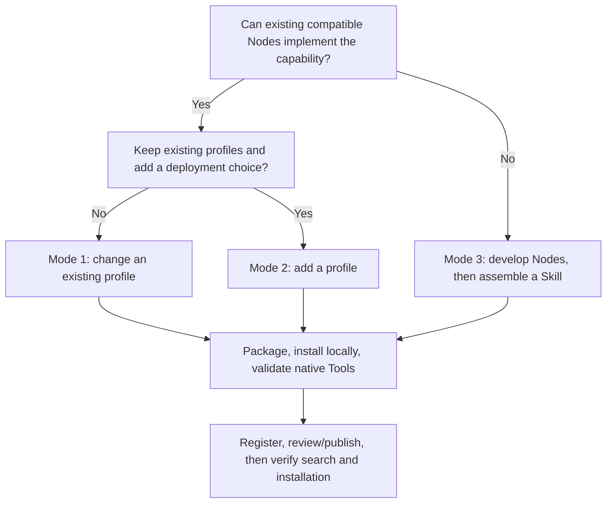

# TrackB Skill Development Manual

[English](SKILL_DEVELOPMENT.md) | [简体中文](SKILL_DEVELOPMENT_zh.md)

[Overview](README.md) · [Repositories](REPOSITORIES.md) · [Protocols](PROTOCOLS.md) · [Runtime](RUNTIME.md) · [Skill development](SKILL_DEVELOPMENT.md)

Choose among three extension modes based on whether compatible Nodes already implement the target capability,
then decide whether binaries must be rebuilt. The executable model/profile example is [PIPER_X_DEMO.md](../PIPER_X_DEMO.md).

**Platform availability:** External resource submissions and changes to existing registered repositories are not yet open. They must wait for the approval service to be completed and opened. Current registration/publication is administrator-managed. Local development and validation can proceed; platform publication steps below are conditional on that workflow becoming available. See the [contribution guide](../../../CONTRIBUTING.md).

## 1. Three development modes and difficulty

| Mode | Typical goal | Main changes | Node artifacts | Difficulty and skills |
| --- | --- | --- | --- | --- |
| 1: Configure an existing profile | Initial state, control parameters, camera, allowed speed/tolerances | Existing YAML, related assets/docs | Usually preserve locks | Low: schemas, units, startup/debugging; still assess physical effects |
| 2: Add a profile | Another robot/scene alongside existing choices | Profile, model/descriptor, manifest, Tool frames, workflow | Preserve locks when supported | Medium: kinematics, model conversion, joint/frame mapping, configuration consistency |
| 3: Develop Nodes and assemble a Skill | New device protocol, algorithm, message capability or Tool | Source, tests, build/publication, dataflow, Skill | New versions/identities/digests | High: relevant Python/C++/Rust, Dora/Arrow, lifecycles and integration |

Difficulty follows boundaries, not file count. Configuration can affect contact, stability or hardware;
a new profile can reveal unsupported degrees of freedom/control modes, requiring mode three.



## 2. Mode one: configure an existing profile

### 2.1 Applicable scope

Existing Nodes support the model/messages and the requested change fits their public configuration schemas:
initial joint angles, camera output, controller gains or allowed Tool speed scales, for example.
Unknown YAML keys do not add binary capabilities; relaxed tolerances must not hide model/frame errors.

### 2.2 Procedure

1. Pin baseline Skill/profile, Core/Dora and Node locks; first run the unchanged profile.
2. Create an independent copy of the validated Bundle, preserving the original rather than editing a running/shared installation.
3. Change target parameters and dependent configuration together: initial limits, gripper units, controller and descriptor must agree.
4. If groups, frames, Tool bounds or asset locations change, update Gateway ToolSpec, required_assets and workflow documentation.
5. Use your own Skill identity/new revision, package with the official script, stop the old Runtime and install locally.
6. Check inspect, dependency digests, startup, Tool context, representative native Actions, failure handling and stop.
7. Keep validation evidence locally; register/publish through the platform when sharing, without overwriting existing version assets.

Example: the [Piper X configuration table](../PIPER_X_DEMO.md#42-configuration-changes) shows cross-file consistency;
[native validation](../PIPER_X_DEMO.md#6-native-validation-of-both-control-modes) supplies checks after tuning.
Full Piper X integration changes the model and exceeds parameter tuning; this mode reuses its configuration/validation procedure.

## 3. Mode two: add a profile

### 3.1 Goal and layout

Keep profiles such as `mujoco-piper`, adding another entry to the Skill's `profiles` mapping:

```text
my-skill/
├── skill.yaml
├── SKILL.md
├── profiles/
│   ├── mujoco-piper/...
│   └── mujoco-my-arm/...
└── assets/robots/
    ├── piper/...
    └── my_arm/...
```

A profile is a deployment choice, not a Node type. Existing simulator, motion server, controller and
Gateway/provider versions must collectively support the new dimensions, joint types, modes and state representation.

### 3.2 Procedure

1. Copy a suitable original profile into a new directory; preserve original profiles/assets and avoid editing installed files.
2. Pin model source/revision/license; define logical joints, limits, initial pose, base and TCP.
3. Convert URDF/MJCF and check FK/servo behavior, logical/physical gripper mapping and actuators.
4. Update simulator, motion, controller, sim-control and Gateway configuration; verify paths, groups, frames, units and schemas.
5. Keep/adapt port connections. Preserve immutable Node locks if binaries are unchanged; remove matching required_tools/binaries when removing capabilities.
6. Register the complete profile in the manifest: dataflow, required_assets, required_binaries, required_tools and environment.
7. Update robot selection/constraints in SKILL.md, increment Skill version, package/install and validate old and new profiles.
8. Stop the current Runtime before switching; resolve port/device contention and validate dependencies, native motion and stop before registration.

This is a profile fragment to add to `skill.yaml`, not a complete manifest; assets must exist.
It assumes the existing six-axis-arm/parallel-gripper chain. Adapt it for other capabilities:

```yaml
profiles:
  mujoco-my-arm:
    dataflow: profiles/mujoco-my-arm/dataflow.yaml
    required_tools:
      - sim.get_robot_info
      - sim.set_joint_positions
      - sim.move_eef
      - sim.set_gripper_opening
      - sim.reset
    required_binaries:
      - gateway
      - sim_control_policy
      - motion_action_policy
      - motion_server
      - joint_trajectory_controller
      - gripper_action_policy
      - gripper_action_controller
      - mujoco_sim
      - image_viewer
    required_assets:
      - assets/robots/my_arm/robot.yaml
      - assets/robots/my_arm/my_arm.urdf
      - assets/robots/my_arm/mjcf/scene.xml
      - assets/robots/my_arm/mjcf/my_arm.xml
    required_environment: []
    environment: {}
```

Keep existing `profiles`; do not replace the manifest with this fragment.
`required_tools` overrides rather than appends the top-level list, so list every Tool required by this profile.
`gateway_url` is Skill-level in the current manifest and must match the selected Gateway configuration.
Concurrent deployments need explicit Skill/address/resource isolation; profiles alone are not concurrent instances.

### 3.3 Reusing the Piper X example

See [PIPER_X_DEMO.md](../PIPER_X_DEMO.md) for model/configuration steps and
[another-arm checklist](../PIPER_X_DEMO.md#9-another-robot-and-deliverables).

**The generator creates a separate `robot-control-sim-piper-x` Skill and keeps only its Piper X profile.**
It illustrates profile internals, not automatic merging of a fourth profile beside three existing ones.
For this mode, start from an unpruned upstream Bundle, integrate the model/profile as above and preserve old choices.
The generator is Piper X-specific, not an arbitrary URDF importer; check its model transformations for another arm.

## 4. Mode three: develop Nodes and assemble a Skill

### 4.1 Interfaces and assembly

Select source using the [catalog](REPOSITORIES.md), then define ports, fields, units, timing, errors,
resource cleanup and cancellation according to [protocols](PROTOCOLS.md).
External device integration is usually Adapter responsibility; graph computation is usually Operator responsibility.

Two integration paths are available:

- **Data-plane Node:** consumes/produces state, observations, trajectories or JointCommand; connect it to existing providers/controllers without adding an Endpoint.
- **New callable capability:** implement an Endpoint operation, configure Gateway ToolSpec/provider routes and connect ToolMessage ports.

A new Tool needs stable tool_id, semantics, input/output schemas, frames/units, readiness,
operation concurrency and terminal results. Implement Query/Action/Session contracts individually;
a Session field alone does not establish a compatible end-to-end Session implementation.

### 4.2 Development and validation order

1. Choose compatible Core/Gateway/Dora/Forge versions; pin locks, source branch and version.
2. Separate deterministic algorithm/driver interfaces from Dora transport and Endpoint handling.
3. Validate serialization, units and ports before ticks, resource lifecycle, timeout/cancel, reconnection and exceptional exit.
4. Test algorithms with unit tests/fake plants; device integration needs device-level checks, not just imports/help.
5. Build for the target OS/architecture; check entrypoint, dependencies, licenses and archive layout.
6. Assemble Gateway configuration, dataflow, assets and manifest; align required_binaries/entrypoints and Tool allowlists/exposure.
7. Update Skill locks using new Node identities/digests; validate local installation and the complete execution chain.
8. Register Node and Skill resources separately; after required review/publication, validate consumer search and installation.

The [Piper X demo](../PIPER_X_DEMO.md) covers Skill assembly and both motion modes while reusing original Nodes;
it does not replace Node source development/testing. Current Forge 2.x source cannot be mixed directly into its older Dora 0.4 locks.

Readable source helps inspect implementations/configuration; binary replacement additionally requires reproducible
source/build/version correspondence. The operator-controls example below uses a catalog-pinned snapshot, not proof
that its commit built the demo's historical binary. Align Dora, messages and related Nodes before replacement.

### Required Node repository README content

New or changed Node repositories must maintain a root capability summary alongside interface changes.
Keep English `README.md` and Chinese `README_zh.md` separate with reciprocal links; synchronize interface facts,
counts, examples and commands in the same change. Count production Nodes, Endpoints, operations and Gateway Tools
separately; CLI aliases, offline utilities and fake plants are not production Nodes.

| Required item | Content |
| --- | --- |
| Production Nodes | Count, names, source/CLI and packaged entrypoints; auxiliary programs separate |
| Tool support | Data-plane only, provider, caller or Gateway; activation and default mode |
| Endpoint | Count, endpoint_id, provider Node, descriptor source; 0 if absent |
| Operation | Per-Endpoint count/names, Query/Action/Session, concurrency, lifecycle controls |
| HTTP Tool API | Methods/paths and request/result contracts; 0 for non-HTTP providers, with Gateway reference |
| Tool binding | tool_id -> endpoint_id / operation -> provider; explicitly configuration-dependent when appropriate |
| Compatibility/build | Wire/schema versions, locks, configuration, build provenance and artifact boundaries |

Suggested root README structure:

```markdown
## Node, Endpoint and Tool API

| Item | Implementation |
| --- | --- |
| Production Nodes | <count, entrypoints; aliases/auxiliary programs separate> |
| Tool support | <mode and activation> |
| Endpoints | <count, IDs, provider, descriptor link> |
| Operations | <names, semantics, concurrency, cancel/stop/status/result> |
| Direct HTTP Tool API | <methods/paths, or 0: exposed by Gateway> |
| Gateway Tools | <configuration-dependent; reference profile ToolSpec> |

<call mapping, requests/results, units/frames, errors, dataflow and compatibility links>
```

`gripper_action_policy` is one Node, one Endpoint and one Action operation. Downstream
`gripper_action_controller` accepts Dora Action-shaped goals/feedback/results without implementing ToolEndpoint.
`motion_action_policy` exposes two operations at one Endpoint; `motion_server` is a separate compute Node.
Gateway owns zero business Endpoints, with deployment-defined routed Endpoints and Tools.

Review against package scripts, build outputs, descriptors, handlers, ToolSpecs and dataflow,
not directory names, class names or old READMEs. See the [capability catalog](REPOSITORIES.md#5-node-endpoint-and-tool-capability-catalog).

### 4.3 Source build example

Prepare Git, uv and Python 3.12 on target Linux x86_64:

```bash
git clone https://github.com/PhyAgentOS/operator-controls.git
cd operator-controls
git checkout cde73dc2a6222d81b01ffc32f69f12cb12e42760
uv sync --frozen --all-groups
uv run pytest -q
bash scripts/build_pyinstaller.sh
```

The frozen-lock build recreates `.venv_build`, produces `dist/joint_trajectory_controller`,
`dist/gripper_action_controller`, `dist/fake_joint_plant`, and checks help/argument errors.
These checks do not replace cross-Node motion validation. Publish algorithm changes from a pinned source revision;
the target must match the client, and macOS executables must not be labeled Linux artifacts.

Source: [build script](https://github.com/PhyAgentOS/operator-controls/blob/cde73dc2a6222d81b01ffc32f69f12cb12e42760/scripts/build_pyinstaller.sh),
[Ubuntu build environment](https://github.com/PhyAgentOS/operator-controls/blob/cde73dc2a6222d81b01ffc32f69f12cb12e42760/.github/workflows/build-ubuntu20.yml).

### 4.4 Archives and build provenance

An `executable_tar_gz` archive must contain the single executable named by entrypoint at its root:

```bash
# Example version: align it with your own source and release.
FORGE_NODE_VERSION=0.1.1
FORGE_NODE_ARCHIVE="joint_trajectory_controller-${FORGE_NODE_VERSION}-linux-x86_64.tar.gz"
tar -C dist -czf "$FORGE_NODE_ARCHIVE" joint_trajectory_controller
sha256sum "$FORGE_NODE_ARCHIVE"
wc -c < "$FORGE_NODE_ARCHIVE"
```

For `directory_tar_gz`, retain the entrypoint-named root directory and its runtime tree.
Do not confuse onefile and onedir layouts. Associate at least the following provenance with each release:

| Information | Required check |
| --- | --- |
| Repository URL, full commit, tag | Identify actual build source; current default branch is not a substitute |
| Build command, lock, OS/architecture | Rebuild/explain runtime dependencies; pin CI workflow revision |
| Entrypoint, archive type | Match layout, executable permissions and installer rules |
| Filename, bytes, archive SHA256 | Storage, Release, Registry metadata and consumer locks identify the same bytes |
| Node name, version, artifact ID | New builds get new immutable identities, without overwriting old assets |
| Licenses/notices | Include statements required by distributed binaries/dependencies |

Update derived Skill `artifacts.nodes.<node_id>` with the new artifact ID/version/SHA256, platform,
archive type and entrypoint. Align dataflow Node IDs, binary placeholders and required_binaries;
increment Skill version, repackage, install locally and validate with `forge-node verify` and native Tools.
Rollback uses previous published immutable artifacts, not replacement bytes under the same version.

## 5. Shared validation and delivery process

| Stage | Facts to establish |
| --- | --- |
| Static consistency | Manifest/profiles parse; paths, units, groups, frames, Tools and binaries agree |
| Model/algorithm checks | Scope-appropriate FK, limits, servo or unit tests; state coverage boundaries |
| Packaging/local installation | Archive layout, size, SHA256, locks, entrypoint, inspect and verify |
| Runtime | Profile startup, Tool context/readiness, representative native terminal results/residuals and stop |
| Agent workflow | If needed: activation, task binding, finalize and verdict; native success is not independent verification |
| Registration/review | Reuse matching existing Nodes; submit resource versions/dependencies/evidence through the platform |
| After publication | Search/install with a compatible consumer API in an isolated instance, then inspect and verify every Node |

GitHub push/Release, platform registration, technical validation, review/publication and Core installation
are separate stages. Editing a static catalog does not establish registration in a new platform.
Use the matching platform version's account/upload/review APIs; pending-review web entries are not necessarily downloadable.

Keep source/model revisions, locks, Bundle/Node digests, build instructions and licenses for each version.
State any missing source/binary provenance instead of substituting the newest default branch.
Rollback restores previous immutable artifacts/locks without overwriting versioned archives.

## 6. Further reading

- [Piper X tutorial](../PIPER_X_DEMO.md): official model, profile, native joint/EEF Actions and stop commands.
- [Runtime relationships](RUNTIME.md): five Tools, three Endpoints/providers and nine Nodes in robot-control-sim.
- [Bundle and Tool integration reference](../README.md): manifest, ToolSpec, task binding and common validation contracts.
