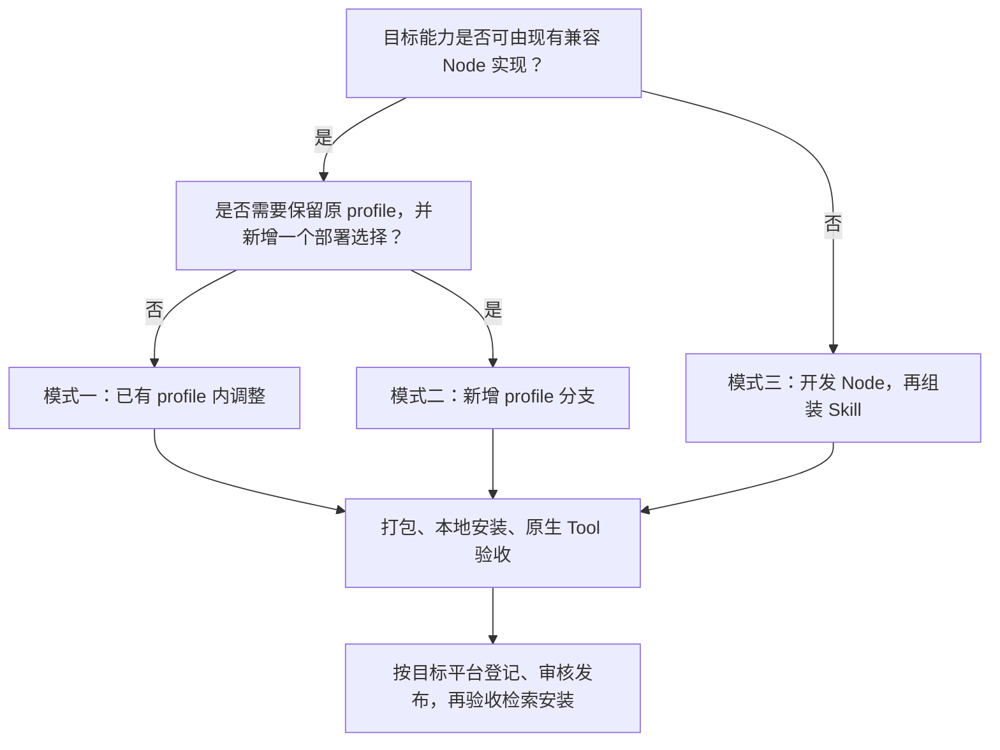

# TrackB Skill 开发手册

[English](SKILL_DEVELOPMENT.md) | [简体中文](SKILL_DEVELOPMENT_zh.md)

[整体架构](README_zh.md) · [仓库目录](REPOSITORIES_zh.md) · [公共协议](PROTOCOLS_zh.md) · [Runtime 关系](RUNTIME_zh.md) · [Skill 开发](SKILL_DEVELOPMENT_zh.md)

本页区分三种二次开发模式。先根据现有 Node 是否支持目标能力选择改动范围，再决定是否重建二进制。
模型/profile 的完整可执行示例见 [PIPER_X_DEMO.md](../PIPER_X_DEMO_zh.md)。

**平台开放范围：** 外部贡献提交及已有登记仓库修改暂未开放，需等待审批服务完成并开放。当前登记与发布由管理员维护；可先进行本地开发验证。下文的平台发布步骤以相关流程开放为前提，详见[贡献指南](../../../CONTRIBUTING_zh.md)。

## 1. 三种模式与难度

| 模式 | 典型目标 | 主要改动 | Node 制品 | 相对难度与要求 |
| --- | --- | --- | --- | --- |
| 一：已有 profile 内配置调整 | 改初始状态、控制参数、相机、允许的速度/容差 | 既有 profile 的 YAML、相关资产或说明 | 通常继承原 locks | 低；理解配置 schema、单位、启动和调试即可，仍需评估物理效果 |
| 二：增加 profile 分支 | 在原机器人列表旁增加一个新的机器人/场景选择 | 新 profile、模型/descriptor、manifest、Tool frame 与工作流 | 现有节点支持时继承 locks | 中；需要运动学、模型转换、关节/坐标映射和跨配置核对能力 |
| 三：独立 Node 开发并组装自己的 Skill | 新设备协议、新算法、新消息能力或新 Tool | Node 源码、测试、构建发布、dataflow 和 Skill | 新版本、新 artifact 身份与摘要 | 高；需要 Python/C++/Rust 中所用语言、Dora/Arrow、生命周期及系统联调能力 |

难度按改动边界划分，不按改了几个文件判断。配置改动也可能影响接触、稳定性或真实设备，
新增 profile 也可能暴露现有 Node 不支持的自由度/控制模式，届时须转入第三种模式。



## 2. 模式一：已有 profile 内配置调整

### 2.1 适用边界

现有 Node 已支持目标模型和消息，所需变化在它公开的配置 schema 内。例如：
调整仿真初始关节角、相机输出、controller gains 或已有 Tool 允许的速度比例。
不要通过增加未知 YAML 字段假定二进制会获得新能力，也不要放宽容差掩盖模型/坐标问题。

### 2.2 具体流程

1. 固定基线 Skill、profile、Core/Dora 版本和 Node locks；先运行未修改的 profile，确认环境可用。
2. 从已校验 Bundle 建立独立工作副本。修改工作副本，保留原包，不直接编辑正在运行或共享的已安装目录。
3. 只改目标参数，同时检查依赖配置。例如初始状态须满足限位；夹爪单位和 controller、descriptor 必须一致。
4. 若 group、frame、工具范围或资产位置发生变化，同步 Gateway ToolSpec、required_assets 和工作流说明。
5. 使用自己的 Skill 身份或新的修订版本，运行官方打包脚本，停止旧 Runtime 后本地安装。
6. 检查 inspect、依赖 Node 摘要、启动、Tool context、代表性原生 Action、失败处理及停止。
7. 保留本地验收材料；需要共享时，按目标平台完成登记与发布，不覆盖已有版本资产。

**对应示例**：[Piper X 配置改动表](../PIPER_X_DEMO_zh.md#42-配置改动表)说明多个配置如何保持一致；
[Piper X 原生验收](../PIPER_X_DEMO_zh.md#6-两种控制方式的原生验收)可作为调参后的检查方法。
Piper X 整体接入包含模型变化，超出单纯调参；这里复用的是配置核对与验收步骤。

## 3. 模式二：增加 profile 分支

### 3.1 目标与文件结构

保留原 `mujoco-piper` 等分支，在同一 Skill 的 `profiles` 映射中增加一个选择：

```text
my-skill/
├── skill.yaml
├── SKILL.md
├── profiles/
│   ├── mujoco-piper/...
│   └── mujoco-my-arm/...
└── assets/robots/
    ├── piper/...
    └── my_arm/...
```

Profile 是部署选择，不是新的 Node 类型。新机械臂的关节维度、关节类型、执行模式和状态表达
必须能由现有 simulator、motion server、controller 和 Gateway/provider 版本共同支持。

### 3.2 具体流程

1. 从原 Bundle 的合适 profile 复制出新目录，保留原目录与资产；不要在已安装目录操作。
2. 固定新模型的来源/revision/许可证，定义逻辑关节、限位、初始姿态、base 和 TCP。
3. 完成 URDF/MJCF 转换和 FK/伺服检查；确认逻辑夹爪与物理关节、actuator 的映射。
4. 更新新分支中的 simulator、motion、controller、sim-control 和 Gateway 配置，核对路径、group、frame、单位与 schema。
5. 保留或调整 dataflow 端口连接。若 Node 未变，保持其不可变 locks；移除能力时也同步 required_tools/binaries。
6. 在 manifest 注册新 profile，填写完整 dataflow、required_assets、required_binaries、required_tools 和 environment。
7. 更新 SKILL.md 的机器人选择和约束，递增 Skill 版本，再打包、本地安装并验证新旧分支。
8. 切换 profile 前停止当前 Runtime，检查端口/设备占用；完成依赖解析、原生动作和停止验收后再登记发布。

以下是添加到 `skill.yaml` 的 profile 结构示例；它不是完整 manifest，资产文件也须实际提供。
该示例假设复用支持六维臂和平行夹爪的既有链，其他机器人应按实际能力调整：

```yaml
profiles:
  mujoco-my-arm:
    dataflow: profiles/mujoco-my-arm/dataflow.yaml
    required_tools:
      - sim.get_robot_info
      - sim.set_joint_positions
      - sim.move_eef
      - sim.set_gripper_opening
      - sim.reset
    required_binaries:
      - gateway
      - sim_control_policy
      - motion_action_policy
      - motion_server
      - joint_trajectory_controller
      - gripper_action_policy
      - gripper_action_controller
      - mujoco_sim
      - image_viewer
    required_assets:
      - assets/robots/my_arm/robot.yaml
      - assets/robots/my_arm/my_arm.urdf
      - assets/robots/my_arm/mjcf/scene.xml
      - assets/robots/my_arm/mjcf/my_arm.xml
    required_environment: []
    environment: {}
```

新增键时保留已有 `profiles` 内容；不能用上面的片段覆盖原 manifest。
`required_tools` 是覆盖而非追加顶层列表，应列全该分支需要的工具。
当前清单的 `gateway_url` 是 Skill 级字段；同一地址要与所选分支的 gateway 配置一致。
需要同时运行不同部署时，应另行设计独立 Skill/地址及资源隔离，不把 profile 分支当作并发实例机制。

### 3.3 Piper X 示例如何复用

模型与配置步骤见 [PIPER_X_DEMO.md](../PIPER_X_DEMO_zh.md)，检查项见
[接入下一种机械臂](../PIPER_X_DEMO_zh.md#9-接入下一种机械臂与提交交付物)。

**示例生成器创建的是独立 `robot-control-sim-piper-x` Skill，并裁剪为仅保留 Piper X profile。**
它示范了新 profile 的内部配置，不是“保留三个旧 profile、再追加一个分支”的自动化工具。
要完成本节模式，需以未裁剪的上游 Bundle 为工作基础，按上述步骤合入新的模型/profile，并保留原分支。
生成器也不是任意 URDF 的通用导入器，下一种机械臂需核对其具体模型处理逻辑。

## 4. 模式三：独立开发 Node 并组装自己的 Skill

### 4.1 决定接口与组装方式

先按 [仓库目录](REPOSITORIES_zh.md) 选择基础代码，并依 [公共协议](PROTOCOLS_zh.md) 定义端口、字段、
单位、时序、错误、资源释放与取消行为：设备对外接入通常属于 Adapter，图内算法通常属于 Operator。

存在两种组装方式：

- **数据平面 Node**：仅消费/产生状态、观测、轨迹或 JointCommand。可连接到已有 provider 和控制链，不必新增 Endpoint。
- **新调用能力 Node**：需要由调用者直接使用时，实现 Endpoint operation，配置 Gateway ToolSpec/provider 路由，并接入 ToolMessage 端口。

如果新增 Tool，应同时明确稳定 tool_id、semantics、input/output schema、frame/单位、readiness、
operation 的并发限制及终态结果。Query/Action/Session 按各自契约实现；不能仅增加一个 Session 字段
就假定所选 Gateway/provider 版本支持完整 Session 链路。

### 4.2 开发与验证顺序

1. 选择兼容的 Core/Gateway/Dora/Forge 消息版本；固定依赖锁，建立自己的源码分支和版本。
2. 把可确定性测试的算法/驱动接口与 Dora 收发、Endpoint handler 分离。
3. 先验证状态/命令序列化、单位和端口，再验证 tick、资源开关、超时/取消、重连或异常退出。
4. 对算法用单元测试和 fake plant；对设备适配补设备层验证，不将 import/帮助检查当作真机验收。
5. 在目标 OS/架构构建可执行制品，验证 entrypoint、依赖、许可证和归档结构。
6. 组装自己的 Gateway 配置、dataflow、资产和 manifest。使 required_binaries 与 entrypoint、Tool allowlist 与暴露能力一致。
7. 使用新的 Node artifact 身份和摘要更新 Skill locks，再执行本地安装与完整执行链验收。
8. 按平台流程分别登记新增 Node 和 Skill，等待所需审核发布后验证消费者检索与安装。

[Piper X demo](../PIPER_X_DEMO_zh.md)展示后半段的 Skill 组装和双控制模式验收；它复用原始 Node，
不代替这里要求的 Node 源码开发与测试。特别是，当前 Forge 2.x 源码不能直接混入该 demo 的 Dora 0.4 旧锁集合。

源码可读解决实现和配置查询；要替换二进制，还需建立可复现的构建与版本对应关系。
以下以 `operator-controls` 为入口示范构建步骤，使用仓库目录中的固定源码快照。
它不证明该提交是 Piper X 示例锁定二进制的构建来源，也不能直接替换示例的旧版 Node。
使用新构建前，须在目标 Skill 中统一 Dora、Forge 消息和相关节点的兼容版本。

### Node 仓库 README 必填内容

后续新建或修改 Node 仓库时，必须在根 README 维护能力摘要，并随接口修改一并更新。
英文使用 `README.md`，中文使用 `README_zh.md`，顶部互相链接；两份独立排版，不在同一份正文中交错翻译。
接口事实、数量、示例与命令保持一致，修改时同步维护两份。
独立统计生产 Node、Endpoint、operation 和 Gateway Tool；CLI 别名、离线工具和 fake plant 不计为生产 Node。

| 必填项 | 写清什么 |
| --- | --- |
| 生产 Node | 数量、名称、源码/CLI 与打包 entrypoint；辅助程序另列 |
| Tool 支持 | 仅数据平面、provider、caller 或 Gateway；启用配置及默认模式 |
| Endpoint | 数量、endpoint_id、provider Node、descriptor 源码链接；不支持时填 0 |
| operation | 每个 Endpoint 的数量与名称、Query/Action/Session、并发和生命周期控制 |
| HTTP Tool API | 方法/路径、参数/结果契约；provider 不监听 HTTP 时填 0，并指向 Gateway |
| Tool 绑定 | tool_id → endpoint_id / operation → provider Node；绑定依赖配置时明确说明 |
| 兼容性与构建 | schema/Wire 版本、依赖锁、配置示例、构建来源与制品版本边界 |

推荐根 README 结构：

```markdown
## Node、Endpoint 与 Tool API

| 项目 | 当前实现 |
| --- | --- |
| 生产 Node | <数量、入口；别名和辅助程序单列> |
| Tool 支持 | <模式与启用条件> |
| Endpoint 数 | <数量、ID、provider、descriptor 链接> |
| operation 数 | <名称、语义、并发与 cancel/stop/status/result> |
| 直接 HTTP Tool API | <方法/路径，或 0：由 Gateway 暴露> |
| Gateway Tool 数 | <配置决定；指向具体 profile 的 ToolSpec> |

<调用映射、请求/结果、单位/frame、错误、数据流和兼容性链接>
```

例如 `gripper_action_policy` 是一个 Node、一个 Endpoint、一个 Action operation；
其下游 `gripper_action_controller` 虽接收 Dora Action 形状的目标/反馈/结果，却没有 ToolEndpoint。
`motion_action_policy` 提供一个 Endpoint 的两个 operation，`motion_server` 是另一个计算 Node。
Gateway 的业务 Endpoint 数为 0，其路由数量与外部 Tool 数取决于部署配置。

审阅时对照 package scripts、构建输出、descriptor、handler、ToolSpec 和 dataflow，
不要由目录名、类名或旧 README 推断当前能力。完整仓库核查摘要见
[Node 与 Tool 能力清单](REPOSITORIES_zh.md#5-nodeendpoint-与-tool-能力清单)。

### 4.3 源码构建示例

在目标 Linux x86_64 构建环境中准备 Git、uv 和 Python 3.12：

```bash
git clone https://github.com/PhyAgentOS/operator-controls.git
cd operator-controls
git checkout cde73dc2a6222d81b01ffc32f69f12cb12e42760
uv sync --frozen --all-groups
uv run pytest -q
bash scripts/build_pyinstaller.sh
```

脚本使用 frozen lock 重建 `.venv_build`，生成 `dist/joint_trajectory_controller`、
`dist/gripper_action_controller` 和 `dist/fake_joint_plant`，并检查帮助与参数错误处理。
这些检查不替代跨节点运动测试。修改算法后，应先更新对应源码版本并提交到自己的分支，再构建最终发布制品。
构建目标须与客户端匹配；macOS 可执行文件不能标记为 Linux 制品。

实现依据：[构建脚本](https://github.com/PhyAgentOS/operator-controls/blob/cde73dc2a6222d81b01ffc32f69f12cb12e42760/scripts/build_pyinstaller.sh)、
[Ubuntu 构建环境](https://github.com/PhyAgentOS/operator-controls/blob/cde73dc2a6222d81b01ffc32f69f12cb12e42760/.github/workflows/build-ubuntu20.yml)。

### 4.4 归档与制品溯源

单文件制品按 `executable_tar_gz` 打包，归档根目录必须是 entrypoint 指定的可执行文件：

```bash
# 示例版本；应与自己的源码和发布版本一致。
FORGE_NODE_VERSION=0.1.1
FORGE_NODE_ARCHIVE="joint_trajectory_controller-${FORGE_NODE_VERSION}-linux-x86_64.tar.gz"
tar -C dist -czf "$FORGE_NODE_ARCHIVE" joint_trajectory_controller
sha256sum "$FORGE_NODE_ARCHIVE"
wc -c < "$FORGE_NODE_ARCHIVE"
```

若使用 `directory_tar_gz`，则保留 entrypoint 同名根目录及其运行时树；
不要把 onefile 和 onedir 两类归档混用。每个发布资产至少关联以下信息：

| 信息 | 对应的检查 |
| --- | --- |
| 仓库 URL、完整 commit、tag | 能定位实际参与构建的源码；公开最新分支不能代替 commit |
| 构建命令、依赖锁、系统与架构 | 能重建或解释运行环境；保留 CI workflow 的固定版本 |
| entrypoint、archive type | 与归档结构、可执行权限和安装器规则一致 |
| 文件名、字节数、归档 SHA256 | 对象存储、Release、Registry 元数据和消费者 lock 指向相同字节 |
| Node 名称、版本、artifact ID | 新构建使用新的不可变身份，不覆盖原版本资产 |
| 许可证及第三方声明 | 包含分发二进制及其依赖所需的声明 |

在派生 Skill 的 `artifacts.nodes.<node_id>` 中填写新 artifact ID/version/SHA256、
目标平台、归档类型和 entrypoint。保持 dataflow 使用的 node ID、binary 占位符及 required_binaries 一致，
再递增 Skill 版本、重新打包，并通过本地安装、`forge-node verify` 和原生 Tool API 验收。
回退时安装上一组已发布的不可变版本，不用原版本号覆盖新旧归档。

## 5. 三种模式共用的验收与交付流程

| 阶段 | 必须确认的事实 |
| --- | --- |
| 静态核对 | manifest/profile 可解析，所有路径、单位、group、frame、Tool 和 binary 声明一致 |
| 模型/算法检查 | 按改动范围验证 FK、限位、伺服或算法单元测试；说明覆盖边界 |
| 打包与本地安装 | 归档结构、字节数、SHA256、Node locks 和 entrypoint 一致，inspect/verify 通过 |
| Runtime 验收 | 从所选 profile 启动，Tool context/readiness 可用；执行代表性原生调用并检查终态、误差和停止 |
| Agent 工作流验收 | 需要 Agent 时单独检查激活、任务绑定、finalize 与 verdict，不用原生动作成功替代独立验证 |
| 平台登记/审核 | 先比对已有身份，复用匹配的 Node；提交新的资源版本、依赖和所需证据，经过目标平台流程 |
| 发布后验收 | 通过与该平台 API 匹配的消费者检索、安装到独立实例，再 inspect 并逐 Node verify |

GitHub push/Release、资源平台登记、技术校验、审核发布、Core 下载安装是不同阶段。
三种开发模式都不通过“修改静态目录”来证明新平台登记已生效；账号和上传/审核接口以目标平台对应版本说明为准。
也不要把网页显示待审核条目当作该版本已可被消费者下载。

每个新版本保留源码/模型 revision、依赖锁、Bundle/Node 摘要、构建说明与许可证。
完整源码对应关系未证明时，明确保留这个限制，不以最新默认分支冒充旧二进制来源。
回退使用上一组不可变制品和 locks，不覆盖同版本归档。

## 6. 进一步阅读

- [Piper X 完整 demo](../PIPER_X_DEMO_zh.md)：从官方模型到 profile、两种原生 Action 和停止的完整命令。
- [Runtime 实际关系](RUNTIME_zh.md)：robot-control-sim 的五个 Tool、三个 Endpoint、三个 provider 与九节点图。
- [Bundle 与 Tool 接入参考](../README_zh.md)：manifest、ToolSpec、任务绑定和通用验收契约。
