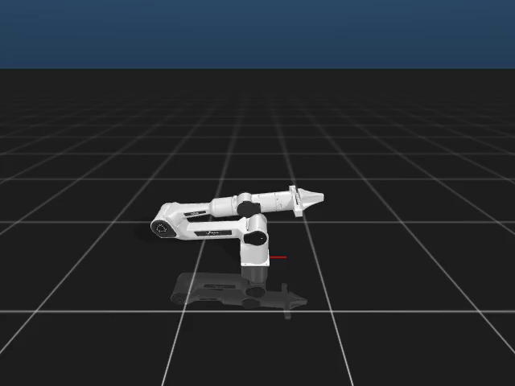
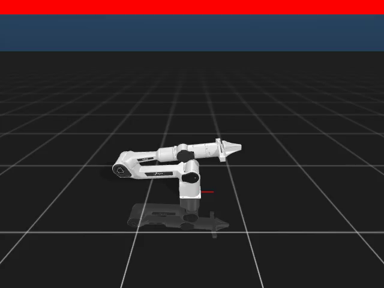

# Beginner simulation functional report

[English](VALIDATION.md) | [简体中文](VALIDATION_zh.md)

Validated on **8 November 2026** using Linux x86_64, Python 3.11, Core 1.1.1, Dora CLI/Python 0.4.1, robot-control-sim 0.1.2, ffmpeg/libx264 and Xvfb. An isolated environment and PAOS instance kept the existing machine configuration intact. All nine official Node archives were checked against their locked SHA-256 digests.

## What works

| User action | Observed result |
| --- | --- |
| Build/install the local tutorial Skill and start its viewer profile | All required services started; robot discovery identified the simulated Piper and joint limits. |
| Reset, move joint1 by 0.2 radians, reset again | All three Actions reached successful terminal results in each of the viewer, recorder and edited-recorder profiles (nine Actions total). Both resets confirmed `episode_reset` and `rehomed`; each move stayed below the unchanged 0.03 rad error limit. Exact errors are in [validation.json](validation.json). |
| Replace the viewer with the recording Node | A playable H.264/yuv420p MP4 contains 900 frames, 640×480, 30 seconds. The eight control Nodes and Tool input buffers match the local viewer profile. |
| Copy recorder source, add a red strip, rebuild and reconnect | A second 900-frame MP4 shows the red top strip; the same reset/move/reset exercise passes. The original installed Skill and its Node locks remain unchanged. |
| Stop each profile | Each tutorial runtime stopped; the test-owned coordinator/daemon and display were cleaned up. |

[View simulation video](media/simulation.mp4) · [View edited-node video](media/custom-simulation.mp4)




The videos show temporal image changes, not just still frames. Robot success is established separately by native Action results, not by appearance or HTTP admission. Media hashes and summarized checks are in [validation.json](validation.json). The supplied videos are recorded examples, not live telemetry.

## Tests and reproduction

The Linux run passed 13 beginner tests plus 11 subtests, covering decoding, real encoding, output preservation, failure cleanup, source-copy isolation and Action-result checks. Another 78 existing tests passed across Skill runtime/manifest/CLI, environment injection, archive containment, Node installation and Forge Tool client modules. This is a focused regression, not the entire repository test suite.

Follow the [walkthrough](README.md) to reproduce the three profiles and generate your own video and Action reports. Run the focused checks with:

```bash
python -m unittest discover -s tests -p 'test_beginner_*.py' -v
python -m pytest -q tests/test_skill_runtime_manager.py tests/test_skill_runtime_manifest.py \
  tests/test_skill_runtime_cli.py tests/test_environment_injection.py tests/test_archive_link_containment.py \
  tests/test_node_installer_directory.py tests/test_forge_tool_client.py
```

Use new output paths for every run. A shorter 360-frame recording was also exercised before the default 900-frame run; it is not substituted for the default-length evidence above.

## Initial failure and remaining limits

The first unmodified published-profile run failed: the viewer lacked a display library and the final reset became `unknown` at its configured deadline. That Action was not automatically replayed, and the run was retained as a failure. Missing display libraries were supplied in the isolated environment. Both derived tutorial profiles now explicitly set Tool input `queue_size=1000`, addressing the known small-queue drop risk described in [Gateway #13](https://github.com/PhyAgentOS/adapter-forge-gateway/issues/13). These changes were tested again on the same Linux host, without increasing Action deadlines or relaxing motion limits. They do not prove the exact cause of the first unknown result or fix every transport/result-lookup race.

The three preferred LAN hosts were unavailable at SSH connection time, so the authorized cloud fallback was selected before functional tests. A test failure did not trigger a host change. No real robot or resource registry publication was involved. Model-driven `paos agent` conversation, other operating systems, long-running reliability and concurrent users of the same Gateway port are outside this validation. The recorder uses a fixed video frame rate rather than measured wall-clock timing; its video is not physical-success evidence.
