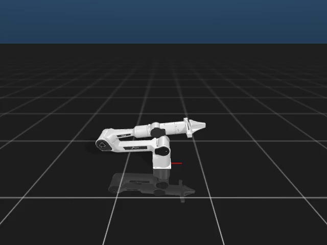
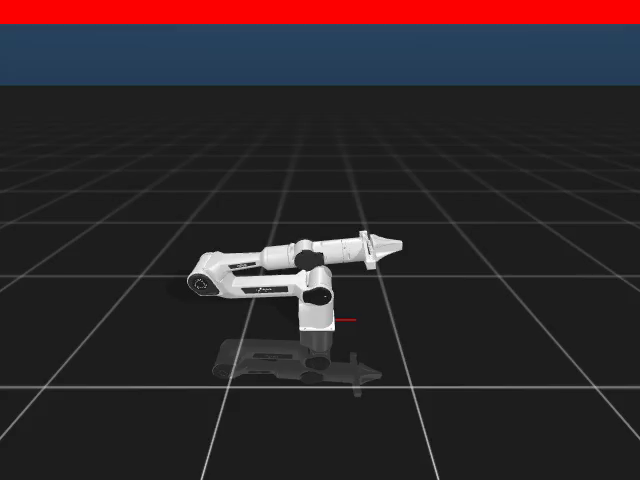

# 新手仿真功能测试报告

[English](VALIDATION.md) | [简体中文](VALIDATION_zh.md)

验证日期：**2026 年 11 月 8 日**。环境为 Linux x86_64、Python 3.11、Core 1.1.1、Dora CLI/Python 0.4.1、robot-control-sim 0.1.2、ffmpeg/libx264 及 Xvfb。测试使用独立环境和 PAOS 实例，保留机器原有配置；九份官方 Node 制品均按锁定的 SHA-256 校验。

## 已验证的功能

| 用户操作 | 实际结果 |
| --- | --- |
| 构建、安装本地教程 Skill，启动查看器配置 | 所需服务启动成功；发现结果确认是仿真 Piper，并返回关节及限位。 |
| 复位、joint1 移动 0.2 弧度、再次复位 | 查看器、录制器及修改后录制器三种配置各完成三个 Action，共九个成功终态。两次复位均确认 `episode_reset` 和 `rehomed`；运动误差均低于原定 0.03 弧度，精确值见 [validation.json](validation.json)。 |
| 将查看器替换成录制节点 | 生成可播放的 H.264/yuv420p MP4：640×480、900 帧、30 秒。八个控制节点及 Tool 输入队列与本地查看器配置一致。 |
| 复制录制源码、加入红条、重新构建并接入 | 第二段 900 帧视频顶部出现红条，同样的复位／移动／复位测试通过。原安装 Skill 和 Node 锁定信息未改动。 |
| 停止各个配置 | 教程运行实例均停止；测试自己启动的协调器、守护进程及显示环境已清理。 |

[查看仿真视频](media/simulation.mp4) · [查看修改节点后的视频](media/custom-simulation.mp4)




视频包含随时间变化的画面，并非静态截图。机械臂动作是否成功另由原生 Action 结果判断，不能凭画面或 HTTP 接收确认得出结论。视频摘要校验值和结果摘要见 [validation.json](validation.json)。这些是已录制示例，不是实时状态。

## 测试与复现

Linux 上通过 13 项新手示例测试和 11 项子测试，覆盖解码、真实编码、原文件保护、失败清理、源码副本隔离及 Action 结果判断；另外通过 78 项已有测试，涉及 Skill 运行管理／清单／CLI、环境注入、归档路径保护、Node 安装及 Forge Tool 客户端。本次属于针对改动的回归，并非整个仓库的完整测试套件。

按[教程](README_zh.md)复现三种配置，即可生成自己的视频和 Action 报告。针对性测试命令：

```bash
python -m unittest discover -s tests -p 'test_beginner_*.py' -v
python -m pytest -q tests/test_skill_runtime_manager.py tests/test_skill_runtime_manifest.py \
  tests/test_skill_runtime_cli.py tests/test_environment_injection.py tests/test_archive_link_containment.py \
  tests/test_node_installer_directory.py tests/test_forge_tool_client.py
```

每轮使用新输出路径。默认 900 帧验证前还执行过 360 帧短录制；以上结论依据默认长度的验证，不用短视频替代。

## 首次失败及适用范围

首次运行未经修改的已发布配置失败：查看器缺少显示库，最后一次复位到达既定时限后成为 `unknown`。系统没有自动重放该 Action，该轮保留为失败。随后在独立环境补齐显示库；两个派生教程配置均显式设置 Tool 输入 `queue_size=1000`，缓解 [Gateway #13](https://github.com/PhyAgentOS/adapter-forge-gateway/issues/13) 已记录的小队列丢消息风险。修改后仍在同一台 Linux 主机复测，没有延长 Action 时限或放宽运动误差。这不能证明首次未知结果的精确原因，也不能消除全部传输或结果查询竞态。

三台优先局域网机器在 SSH 连接阶段不可用，因此在功能测试前选用了已授权云端备用机。功能失败没有触发换机器。未操作真实机械臂，也未发布资源平台制品。本次不覆盖模型驱动的 `paos agent` 对话、其他操作系统、长时间可靠性及多个用户共用 Gateway 端口。视频使用固定帧率，不代表实际墙钟时长，也不能作为物理任务成功的证据。
